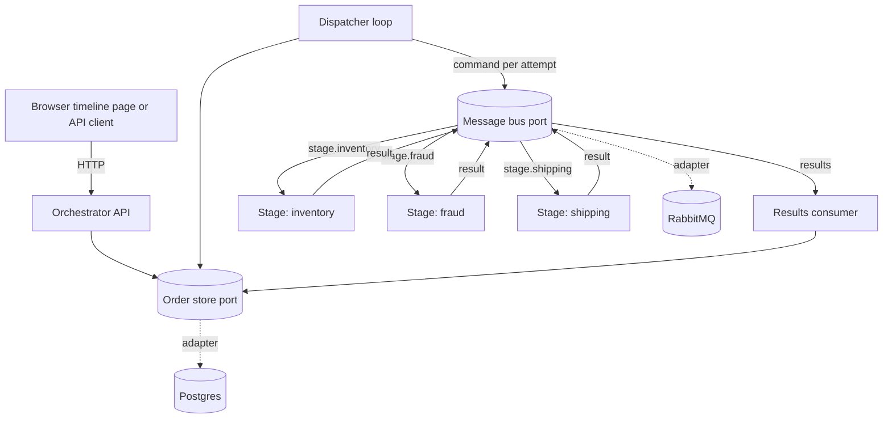

# flowforge-order-orchestrator

An order is submitted through a REST API and runs through a configurable sequence of slow, sometimes failing stages (inventory, fraud, shipping) until it lands in a terminal state. Anyone can ask where an order is and how it got there, in the API or on a small timeline page. The stages are simulated; the point is the orchestration, the state model, and the visibility of the workflow.

## Architecture



- **Orchestrator** (FastAPI). Owns the state machine and is the only process that touches the database. It serves the API and the timeline page, and runs two background loops: a dispatcher that publishes one command per stage attempt, and a results consumer that applies each stage's answer.
- **Stage services.** One container per stage, all from one image; `STAGE_NAME` picks the handler. They hold no state: a command carries everything the stage needs, and a result carries everything it produced.
- **RabbitMQ** carries commands (a durable queue per stage) and results (one queue). **Postgres** holds each order and an append-only log of every attempt, which is the history the API and the page show.
- **Ports.** The bus and the store sit behind two small interfaces. Postgres and RabbitMQ are the shipped adapters; in-memory adapters are the second implementation of each, so the state machine and the application are tested with no infrastructure.

An order's life: submit (`pending`), the dispatcher claims it and publishes the first stage's command (`running`), each success advances it to the next stage, and the last success completes it. A transient failure or a missed deadline is retried with backoff up to a cap. A permanent failure runs the undo of every stage already dispatched, in reverse, and the order ends `failed` (every undo succeeded) or `compensation_failed` (an undo gave up).

## Build and run

You need Docker with Compose v2. Nothing else is required to run the system.

```sh
docker compose up -d --build --wait
```

This builds two images (orchestrator and stage), starts Postgres, RabbitMQ, the orchestrator, and three stage services, applies the database migration, and returns once everything is healthy.

- Timeline page: <http://localhost:8000>. Submit an order; you are redirected to its own URL and the page polls until the order finishes.
- API: `http://localhost:8000/api/orders`.
- If port 8000 is taken, set `ORCHESTRATOR_PORT` first (`ORCHESTRATOR_PORT=18000 docker compose up -d --build --wait`).
- Stage logs show one line per processed command: `docker compose logs -f stage-fraud`.
- Stop with `docker compose down`. Data survives in named volumes; `docker compose down -v` wipes it.

### Try the API

```sh
curl -s -X POST localhost:8000/api/orders \
  -H 'Content-Type: application/json' -H 'Idempotency-Key: demo-1' \
  -d '{"payload": {"sku": "A-1"}}'
# {"id": "…", "state": "pending"}   (201; the same key and payload again returns 200)

curl -s localhost:8000/api/orders/<id>    # state, current stage, and every attempt so far
```

Add an outcome script to force what the stages do, per stage, kind, and attempt (`succeed`, `retry`, `reject`, `timeout`; an attempt the script leaves unlisted succeeds):

```json
{"payload": {"sku": "A-1"},
 "script": {"fraud": {"execute": ["retry", "retry", "succeed"]},
            "inventory": {"undo": ["retry"]}}}
```

The page has a field for the same script. Some useful ones: `{"fraud": {"execute": ["reject"]}}` shows compensation, `{"fraud": {"execute": ["timeout"]}}` shows a missed deadline and the retry that follows.

## Design decisions and trade-offs

The reasoning behind each choice, the alternatives that were rejected, and where the build refined the plan are in [`docs/design.md`](docs/design.md). The planning record, with risks and what was deliberately not built, is [`docs/plans/`](docs/plans/), and the research behind it is [`docs/research/`](docs/research/). In short:

| Decision | What it buys | What it costs |
|---|---|---|
| The orchestrator owns the state machine and commands each stage over a broker | One place holds the rules, so history and status come for free | A single coordinator: one instance only, and the dispatcher is not safe to replicate |
| A pure transition function; retries and timeouts only write rows | Every edge of the state diagram is a unit test, and a backoff survives a restart | Recovery is driven by polling, so it is only as fast as the sweep interval |
| One sweep recovers both lost dispatches and silent stages, using a deadline on every command | One mechanism instead of an outbox plus a watchdog | A lost publish or a dead stage costs one attempt and one deadline window (10s by default) |
| RabbitMQ with acknowledge-before-handler, and no broker retries or dead-letter queue | A single retry authority, the orchestrator, so attempts are counted once | A stage that crashes mid-handler loses that command until its deadline fires |
| An order row plus an append-only attempt log, in Postgres | The visible history is the log, and several containers can write safely | No event replay or time-travel; SQLite was rejected because it is not safe across processes |
| An atomic store port: claim, time out, and settle each take a pure callback | An attempt row and its order update land together or not at all, so a crash cannot strand an order | The port is less obvious than separate calls, and the Postgres adapter must keep it in one transaction |
| Undo hooks on every stage, defaulting to a no-op | The compensation path exists and is tested even though simulated stages have no side effects | Extra moving parts for work that is, today, simulated |
| At-least-once delivery, idempotent handlers, and a guarded close of each attempt | A duplicate or late result is harmless and an outcome is applied once | Stage handlers must be idempotent per order and stage |
| One stage image selected by `STAGE_NAME`; a stage list in TOML copied onto each order | Adding a stage is a handler, a Compose service, and a config line; in-flight orders are unaffected by config changes | An order already in flight keeps its old stage list until it finishes |
| A static timeline page with no build step | Nothing to install or build; the page is one file | No component framework, and browser behaviour is checked by hand, not in CI |

What is deliberately out of this version: more than one orchestrator instance, authentication, structured logs and metrics, a manual retry for terminal orders, and Redis and SQLite adapters. The full list is under "Limits" in the design record.

## Change the pipeline

The stage order, retry settings, sweep interval, and adapters are in [`config/pipeline.toml`](config/pipeline.toml). Per-stage overrides go under `[overrides.<stage>]`. An order keeps the stage list it was submitted with, so a config change affects only later orders.

To add a stage:

1. Add `services/stage/handlers/<name>.py` with a `Handler` class that implements `execute` (and `undo` if the stage has side effects to reverse).
2. Add a Compose service that runs the stage image with `STAGE_NAME: <name>` (copy `stage-fraud`).
3. Add `<name>` to `stages` in `config/pipeline.toml`.

The orchestrator and the stage kit need no change.

## Develop and test

Python 3.14 and [uv](https://docs.astral.sh/uv/).

```sh
uv sync
uv run ruff check . && uv run ruff format --check .
uv run pytest -m "not contract and not e2e"   # unit tests, no Docker
uv run pytest -m contract                     # adapters against real Postgres and RabbitMQ
uv run pytest -m e2e                          # builds and drives the whole Compose stack
```

CI (`.github/workflows/ci.yml`) runs lint and format checks on every pull request and the three test suites once a pull request is out of draft, so marking a draft ready for review starts them. The contract and end-to-end suites need Docker. The end-to-end suite runs its own Compose project, picks a free host port, and tears everything down afterwards; it takes a few minutes because it restarts services mid-order.

```text
packages/contracts    messages, outcomes, and the outcome script shared by every service
packages/bus          the message-bus port, its in-memory and RabbitMQ adapters, the consume loop
packages/stage_kit    stage runtime: runner, simulator, handler contract, settings
services/orchestrator state machine, store port and adapters, API, dispatcher, timeline page
services/stage        the three stage handlers and the entrypoint
tests/contract        one suite per port, run against every adapter
tests/e2e             acceptance and restart tests against the Compose stack
docs/                 brief, plan, research, design record, and the AI conversation logs
```

## AI assistants

Three assistants were used, each for a different job. The conversation logs are in [`docs/conversations/`](docs/conversations/).

| Job | Tool and model | What it did | Log |
|---|---|---|---|
| Brainstorming, architecture, plan | Claude Fable 5.1, high effort, in Claude Code | Turned the brief into requirements, ran research on the broker client, retry and sweep patterns, and flow gaps (notes in `docs/research/`), proposed options with trade-offs, and wrote the plan | [`session-d7e11c2d-…`](docs/conversations/session-d7e11c2d-84dc-4bb3-ad51-a24eb20940f8.md) |
| Coding | Claude Sonnet 5.5, xhigh effort, in Claude Code | Implemented the plan one unit at a time, each in its own pull request, tests first where behaviour changed, checking that a test fails when the code it guards is broken. Looked up library docs (aio-pika, SQLAlchemy, Alembic, testcontainers) through Context7 rather than from memory, and drove Chrome to check the timeline page in light and dark mode and at phone width | [`session-69752424-…`](docs/conversations/session-69752424-d5e4-43b4-a438-da6a7eed3c45.md) |
| Code review | Codex with GPT-6.1 Sol, high effort | An independent review of the pull requests by a different model, started after the build; its findings and the fixes they lead to land on top of the last pull request, and its log is added with them | added with the review fixes |

The coding assistant also reviewed each unit before its pull request went up. That caught several real problems (an unbounded header, a consumer that could die silently, a result racing its own deadline), but it was the same model that wrote the code, which is why the independent review is a separate step.

**What I did.** I set the direction and the constraints and made the main architecture choices, which are marked as such in the plan: a config-ordered linear pipeline, compensation built now, an own orchestrator over a broker, RabbitMQ, one container per stage, and history through the status API and the page. I review and merge every pull request myself.
