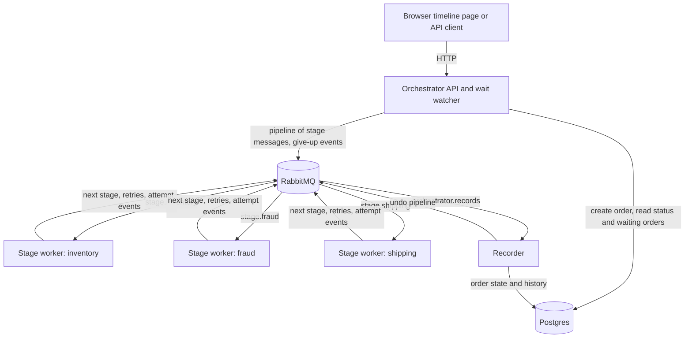

# flowforge-order-orchestrator

An order is submitted through a REST API and runs through a configurable sequence of slow, sometimes failing stages (inventory, fraud, shipping) until it lands in a terminal state. Anyone can ask where an order is and how it got there, in the API or on a small timeline page. The stages are simulated; the point is the orchestration, the state model, and the visibility of the workflow.

## Architecture



- **Orchestrator** (FastAPI). Serves the API and the timeline page. Submitting an order stores it in Postgres and enqueues a [Dramatiq](https://dramatiq.io) pipeline with one message per stage. A background loop, the wait watcher, gives up orders whose work no worker took within the stage's maximum wait.
- **Stage workers.** One container per stage, all from one image; `STAGE_NAME` picks the handler and the queue. Dramatiq hands each worker its stage's messages, chains to the next stage on success, and retries with the delay the worker asks for. Workers hold no state and have no database access: they report each attempt as an event.
- **Recorder.** Run from the orchestrator image, it consumes the attempt events and makes every change to order state and history; the API only inserts a new order. When an order must be compensated, it enqueues the undo pipeline.
- **RabbitMQ** carries the stage messages (a durable queue per stage) and the events (one queue), with publisher confirms. **Postgres** holds each order and an append-only log of every attempt, which is the history the API and the page show.

An order's life: submit (`pending`), the first stage starts (`running`), each success hands the order to the next stage, and the last success completes it. A transient failure or an answer after the stage's deadline is retried with backoff up to a cap. A rejection or exhausted attempts undo every stage that ran, in reverse, and the order ends `failed` (every undo succeeded) or `compensation_failed` (an undo gave up). If no worker picks up a stage's work, the order shows that it is waiting; after the stage's maximum wait (60 s by default) it is given up the same way.

## Build and run

You need Docker with Compose v2. Nothing else is required to run the system. Run every command from the repository root.

### 1. Start the stack

Pick the host port first. The orchestrator uses `8000` unless you choose another one; check that it is free with `lsof -i :8000` (no output means free).

```sh
export PORT=8000                      # or any free port, e.g. 18000
export ORCHESTRATOR_PORT=$PORT        # Compose publishes the orchestrator on this port
export API=http://localhost:$PORT/api/orders

docker compose up -d --build --wait
```

The first build takes a minute or two. The command returns when every container is up and the orchestrator answers. Check it:

```sh
docker compose ps
```

Expected: seven services running (`postgres`, `rabbitmq`, `orchestrator`, `recorder`, `stage-inventory`, `stage-fraud`, `stage-shipping`), and the orchestrator `healthy` with `127.0.0.1:<PORT>->8000/tcp`. The database migration runs automatically when the orchestrator starts.

### 2. Use the timeline page

1. Open `http://localhost:<PORT>` in a browser (<http://localhost:8000> by default).
2. Leave **Order payload** as it is, or put any JSON object there; it is the order data the stages receive.
3. Leave **Outcome script** empty for a normal run, or paste one of the scripts from the table below.
4. Click **Submit order**. The page moves to the order's own address, `/orders/<id>`, and refreshes once a second until the order finishes.
5. To submit another order, click **FlowForge** at the top left, or use the browser's Back button.

Each attempt is one card. Green means succeeded; amber, retry or timed out; red, rejected or exhausted; a pulsing **in progress** tag means the stage is still working; a purple tint marks an undo. A banner says when the order is waiting out a backoff before the next attempt, another when its work is waiting for a stage worker to pick it up, and a notice says when the page cannot reach the server; it keeps the last timeline and retries.

The outcome script forces what a stage does, by stage, by kind (`execute` or `undo`), and by attempt number, so you can see every path on demand. Tokens are `succeed`, `retry`, `reject`, and `timeout`. Attempts the script does not list succeed; stages it does not name behave normally.

| Outcome script | What you should see |
|---|---|
| *(empty)* | inventory, fraud, and shipping succeed; `completed` in about a second |
| `{"fraud": {"execute": ["retry", "retry", "succeed"]}}` | two amber `retry` cards for fraud, the retry banner between them (1 s, then 2 s), then `completed` |
| `{"fraud": {"execute": ["reject"]}}` | fraud `rejected`, then undo cards for fraud and then inventory; ends `failed`, with the reason under the state |
| `{"inventory": {"execute": ["retry", "retry", "retry"]}}` | inventory attempt 3 `exhausted`, then an undo of inventory; ends `failed` |
| `{"fraud": {"execute": ["reject"]}, "inventory": {"undo": ["retry", "retry", "retry"]}}` | the inventory undo itself gives up; ends `compensation_failed` |
| `{"fraud": {"execute": ["timeout"]}}` | fraud stays **in progress** for its 10 s deadline, turns `timed out`, then attempt 2 succeeds; `completed` |

A script that names an unknown stage, or lists more tokens than a stage has attempts (3 by default), is rejected and the reason appears under the form.

### 3. Use the API

Submit an order. `Idempotency-Key` is required; use a new value for every new order.

```sh
curl -s -X POST $API -H 'Content-Type: application/json' -H 'Idempotency-Key: demo-1' \
  -d '{"payload": {"sku": "A-1"}, "script": {"fraud": {"execute": ["retry", "succeed"]}}}'
```

Expected, with status `201`:

```json
{"id": "6eb55f60-e5dd-4e5d-8303-16c9e20826b0", "state": "pending"}
```

Read its status and full history, using the `id` from that response:

```sh
curl -s $API/6eb55f60-e5dd-4e5d-8303-16c9e20826b0
```

Expected, a second or two later:

```json
{"id": "6eb55f60-…", "state": "completed", "current_stage": null,
 "next_attempt_due_at": null, "waiting_for_worker_since": null, "terminal_reason": null,
 "attempts": [
   {"stage": "inventory", "kind": "execute", "attempt": 1, "outcome": "succeeded", "stage_output": {"reservation_id": "res-…"}, ...},
   {"stage": "fraud", "kind": "execute", "attempt": 1, "outcome": "retry", "reason": "simulated transient failure", ...},
   {"stage": "fraud", "kind": "execute", "attempt": 2, "outcome": "succeeded", ...},
   {"stage": "shipping", "kind": "execute", "attempt": 1, "outcome": "succeeded", ...}]}
```

| You send | You get |
|---|---|
| the same `Idempotency-Key` and the same body again | `200` and the same order, no new work |
| the same `Idempotency-Key` with a different body | `409` |
| no `Idempotency-Key` header, or a script with an unknown stage | `422` with the reason |
| a body larger than 64 KiB | `413` |
| `GET` for an id that does not exist | `404` |

### 4. See it recover

**A stage that is down.** Its work waits in the queue and the order shows that it is waiting for a worker; no attempt is spent. When the stage comes back, it runs the work.

1. Stop the fraud stage:
   ```sh
   docker compose stop stage-fraud
   ```
2. Submit an order on the page, or with:
   ```sh
   curl -s -X POST $API -H 'Content-Type: application/json' \
     -H "Idempotency-Key: $(uuidgen)" -d '{"payload": {"sku": "A-1"}}'
   ```
3. Watch the order page. Inventory succeeds, then after two seconds a banner reads "Waiting since … for a fraud worker to pick up the work". The API shows the same moment in `waiting_for_worker_since`, and there is no fraud attempt.
4. Start the stage again within a minute:
   ```sh
   docker compose start stage-fraud
   ```
5. Expected: the banner disappears and the order ends `completed`, with fraud attempt 1 `succeeded`.

**A stage that stays down.** Repeat steps 1 and 2 and leave fraud stopped. After its maximum wait (60 s, plus a 5 s margin) the order is given up: inventory is undone and the order ends `failed` with the reason `fraud unavailable: no worker took it within 60 s`. Start fraud again and its log shows that it dropped the stale work instead of running it:

```sh
docker compose start stage-fraud
docker compose logs --no-log-prefix stage-fraud | grep <id>
```
```text
[...] [contracts.tasks] [INFO] dropped execute of order <id> fraud after waiting 70 s for a worker
```

**The orchestrator restarting.** Submit the `timeout` script from the table, and while fraud is **in progress** run:

```sh
docker compose restart orchestrator
```

Expected: the page shows the connection notice for a few seconds, then carries on; the order ends `completed`. The orchestrator is not on the path a stage takes, and orders live in Postgres, so nothing is lost.

### 5. Look inside

```sh
docker compose logs -f orchestrator recorder stage-inventory stage-fraud stage-shipping   # live logs
docker compose exec rabbitmq rabbitmqctl list_queues name messages consumers                # stage queues, their delay and dead-letter queues, and the records queue
docker compose exec postgres psql -U flowforge -d flowforge \
  -c "select state, count(*) from orders group by state"                         # orders by state
```

Each stage logs one line per attempt it ran (`order <id> <stage> <kind> attempt <n>: <outcome>`) or work it dropped after waiting longer than the stage's maximum.

### 6. Stop

```sh
docker compose down        # stops everything; orders survive in named volumes
docker compose down -v     # stops everything and deletes all orders
```

### If something goes wrong

| Symptom | Fix |
|---|---|
| `port is already allocated` on start | another process holds the port; set a different `PORT` in step 1 and run the block again |
| the page or `curl` cannot connect | check that `PORT` matches `docker compose ps`; after `docker compose down`, start again with step 1 |
| an order shows that it is waiting for a worker | that stage's service is down: `docker compose ps`, then `docker compose logs <service>` for the reason |
| an order never changes state | the recorder applies every change: `docker compose logs recorder` |

## Design decisions and trade-offs

The reasoning behind each choice and the alternatives that were rejected are in [`docs/design.md`](docs/design.md), along with how the system came to run on Dramatiq after a comparison against its first, hand-built dispatcher and against Celery. In short:

| Decision | What it buys | What it costs |
|---|---|---|
| Dramatiq runs the stages; the application owns the recovery policy | Chaining, retries with backoff, acknowledgement after processing, and redelivery come from a library; the code that remains is the policy | Retry state lives in the broker; Dramatiq's `AgeLimit` and `on_failure` do not fit the policy and are replaced by a handoff stamp and the recorder |
| A stage that is down is a visible wait with a maximum, not failed attempts | An outage never spends the retry budget, the page says what the order is waiting for, and stale work is dropped when the stage returns | An order waits up to the stage's maximum (60 s by default) before it is given up |
| One recorder makes every change to an order after it is created, from attempt events | Stage workers need no database access, and one consumer applies events in order | State lags each attempt by one hop through the queue; one recorder instance only |
| RabbitMQ rather than Redis, with publisher confirms | Losing a stage message or an event is unacceptable here; RabbitMQ confirms a message only once it is on disk | A confirm can take a few hundred milliseconds; Redis is the right choice when latency is the top priority and losing the last second of messages is tolerable |
| An order row plus an append-only attempt log, in Postgres | The visible history is the log; the recorder's guards and the status read use row locks and `REPEATABLE READ` snapshots | No event replay or time-travel, and one more service to run. SQLite would hold this version's data, since writes are an insert per order plus one recorder, but it has no row locks and serializes every write on one file |
| Undo hooks on every stage, defaulting to a no-op | The compensation path exists and is tested even though simulated stages have no side effects | Extra moving parts for work that is, today, simulated |
| At-least-once delivery, idempotent handlers, and guarded writes in the recorder | A duplicate or late event cannot change the order, and a redelivered message restarts the same attempt | Stage handlers must be idempotent per order and stage |
| One stage image selected by `STAGE_NAME`; the stage list and each stage's policy copied onto every order | Adding a stage is a handler, a Compose service, and a config line; in-flight orders are unaffected by config changes | An order in flight keeps its old stage list, so a removed stage's service must keep running until those orders are done |
| A static timeline page with no build step | Nothing to install or build; the page is one file | No component framework, and browser behaviour is checked by hand, not in CI |

### Consistency, concurrency, and load

| Property | Guarantee | Ceiling |
|---|---|---|
| Delivery | At-least-once for stage messages and events (persistent messages, durable queues, publisher confirms). A stage message is acknowledged after processing and redelivered if its worker dies | A redelivered message runs the handler again, which is why handlers are idempotent per order and stage |
| Durability | Each event is one transaction in Postgres; a retry waiting out its backoff is a message in Dramatiq's delay queue | Postgres and RabbitMQ are one node each; no replication |
| Submission | Linearizable per idempotency key through a unique constraint; the losing concurrent insert re-reads and replays; SHA-256 of canonical JSON decides replay versus conflict | Replay is checked against the stored order before today's config; it returns the current state, not the original response; keys never expire; the page reuses one key while the user retries the same body; a body is at most 64 KiB, counted as it arrives, and a script lists at most `max_attempts` tokens per stage and kind |
| Status | One snapshot: the order and its attempts are read in one `REPEATABLE READ` transaction | Read from the primary, polled once a second per open page |
| Concurrency | Stages run concurrently across orders, strictly in sequence within one; one recorder applies events in order | A stage worker runs one message at a time; stage services scale by adding replicas. The recorder applies a few hundred events per second on a local Postgres; the API and the watcher can be replicated, the recorder cannot |
| Waiting | A stage that is down is shown as a wait and given up after its maximum; stale work is dropped | Give-up happens within the maximum wait plus 5 s plus one second |
| Load | The payload travels in every stage message, including undo messages | Bytes on the bus per order are payload x stages x attempts x 2 at worst, bounded by the body cap. History is append-only with no retention |
| Clocks | The worker's drop and the watcher's give-up compare timestamps from different containers | Containers must share a clock; the 5 s margin absorbs small drift |

What is deliberately out of this version: more than one recorder, authentication, structured logs and metrics, a manual retry for terminal orders, and conditional or parallel stages. The full list is under "Limits" in the design record.

## Change the pipeline

The stage order, retry settings, the maximum wait for a worker, and the adapters are in [`config/pipeline.toml`](config/pipeline.toml). Per-stage overrides go under `[overrides.<stage>]`. The file is read at startup, so apply a change with `docker compose restart orchestrator`. An order keeps the stage list it was submitted with, so a change affects only later orders; keep a removed stage's service running until its in-flight orders finish.

For example, to give fraud more time, more attempts, and a longer wait for a worker:

```toml
[overrides.fraud]
max_attempts = 5
deadline_seconds = 20
max_wait_seconds = 120
```

To add a stage:

1. Add `services/stage/handlers/<name>.py` with a `Handler` class that implements `execute` (and `undo` if the stage has side effects to reverse).
2. Add a Compose service that runs the stage image with `STAGE_NAME: <name>` (copy `stage-fraud`).
3. Add `<name>` to `stages` in `config/pipeline.toml`.

The orchestrator, the recorder, and the stage kit need no change.

## Develop and test

Python 3.14 and [uv](https://docs.astral.sh/uv/).

```sh
uv sync
uv run ruff check . && uv run ruff format --check .
uv run pytest -m "not contract and not e2e"   # unit tests, no Docker
uv run pytest -m contract                     # the store, the recorder, and the migrations against real Postgres
uv run pytest -m e2e                          # builds and drives the whole Compose stack
```

CI (`.github/workflows/ci.yml`) runs lint and format checks on every pull request and the three test suites once a pull request is out of draft, so marking a draft ready for review starts them. The contract and end-to-end suites need Docker. The end-to-end suite runs its own Compose project, picks a free host port, and tears everything down afterwards; it takes a few minutes because it restarts services mid-order.

```text
packages/contracts    messages, outcomes, the outcome script, and the Dramatiq message contract and middleware
packages/stage_kit    stage runtime: simulator, handler contract, settings
services/orchestrator API, store, Dramatiq pipeline and wait watcher, recorder, timeline page
services/stage        the Dramatiq stage worker and the stage handlers
tests/contract        the store, the recorder, and the migrations against real Postgres
tests/e2e             acceptance and restart tests against the Compose stack
docs/                 the design record
```

## AI assistants

Three tools were used across six jobs.

| Job | Tool and model | What it did |
|---|---|---|
| Brainstorming, architecture, plan | Claude Fable 5.1, high effort, in Claude Code | Turned the brief into requirements, ran research on the broker client, retry and sweep patterns, and flow gaps, proposed options with trade-offs, and wrote the plan |
| Coding | Claude Sonnet 5.5, xhigh effort, in Claude Code | Implemented the plan one unit at a time, each in its own pull request, tests first where behaviour changed, checking that a test fails when the code it guards is broken. Looked up library docs (aio-pika, SQLAlchemy, Alembic, testcontainers) through Context7 rather than from memory, and drove Chrome to check the timeline page in light and dark mode and at phone width |
| Code review and review fixes | Claude Fable 5.1 in Claude Code (the `ce-code-review` skill, run inline); the second round of fixes ran on Claude Opus 5.5 in the same session | Reviewed the twelve pull requests as one stack after the build: correctness, reliability, security, tests, and the consistency, concurrency, and load trade-offs; confirmed findings with probes and mutation tests. Twenty findings, each fixed in the review-fixes pull request or recorded as an accepted limit |
| Library evaluation and the move to Dramatiq | Claude Opus 5.5 in Claude Code, in the same session as the review fixes | Built the system again on Celery and on Dramatiq, ran the end-to-end suite against each, then moved the system to Dramatiq with the waiting-for-a-worker policy and a single recorder |
| Simplification review | ChatGPT | An independent read of the same stack by a different vendor, after the build: twelve behaviour-preserving cuts, each checked against library documentation through Context7, applied in the review-fixes pull request |
| Second code review | Codex with the `ce:review` skill | Re-reviewed the stack after the first round of fixes: confirmed the twelve simplification cuts were applied and found seven new issues in the fixes (a body cap that trusted the header, a lost publish confirmation that reused an attempt, a release that rescheduled settled orders, replays judged against today's config, the status query cost, a page retry that minted a new key, and untested enum checks), all fixed in the same pull request; a third round confirmed the fixes and found nothing new |

The coding assistant also reviewed each unit before its pull request went up. That caught several real problems (an unbounded header, a consumer that could die silently, a result racing its own deadline), but it was the same model that wrote the code, which is why the two reviews above are separate steps by a different model and a different vendor.

**What I did.** I set the direction and the constraints and made the main architecture choices: a config-ordered linear pipeline, compensation built now, RabbitMQ, one container per stage, and history through the status API and the page. After comparing the first, hand-built dispatcher with Celery and Dramatiq versions, I chose to run the stages on Dramatiq and to treat a stage that is down as a visible, bounded wait. I read both review reports, chose which findings to fix, and review and merge every pull request myself.
