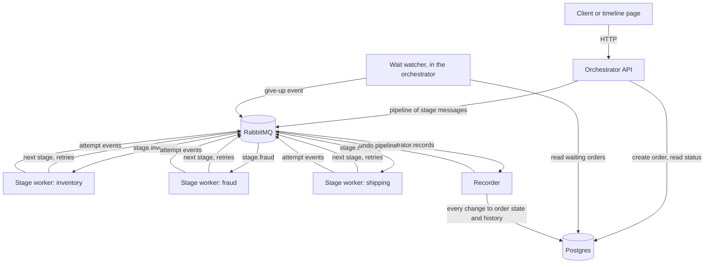
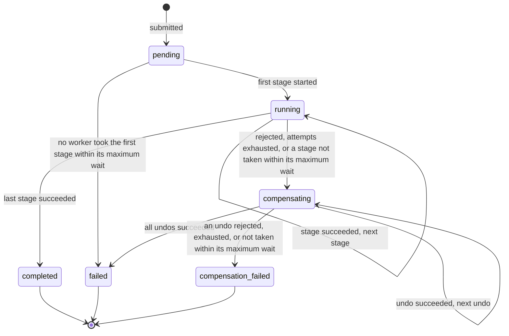

# Design record

How the order orchestrator is built and why. The planning record, with the full requirement list and acceptance examples, is [`docs/plans/2026-10-13-1425-feat-async-order-orchestrator-plan.md`](plans/2026-10-13-1425-feat-async-order-orchestrator-plan.md); the brief is [`brief.md`](brief.md). This file records the current design, the decisions, the alternatives that were rejected, and the evaluation that led to running the stages on Dramatiq ([`library-evaluation.md`](library-evaluation.md)).

## Shape of the system

Three kinds of process share one RabbitMQ and one Postgres:

- **The orchestrator** serves the API and the timeline page. Submitting an order inserts the order row and enqueues a Dramatiq pipeline: one message per stage, each on its stage's queue. The orchestrator also runs the wait watcher, a loop that gives up orders whose work no worker took in time.
- **Stage workers**, one container per stage from one image, run the `flowforge.stage` actor for their queue. They hold no state and have no database access: a message carries everything a stage needs, and the worker reports what happened as events.
- **The recorder**, run from the orchestrator image, consumes `orchestrator.records` and makes every change to order state and attempt history; the API only inserts a new order. When an order must be compensated, it enqueues the undo pipeline.

Dramatiq runs the work: it chains the stages, retries a stage with the delay the worker asks for, acknowledges a message only after processing it, and redelivers it if a worker dies. The application owns the policy: what counts as an attempt, the backoff, the deadline, compensation, and how long work may wait for a worker.

One attempt, from handoff to recorded:

1. A message for the stage is enqueued: by the API for the first stage, by Dramatiq's pipeline for the next stage, by Dramatiq's retry for the next attempt, or by the recorder for an undo. A middleware stamps it with the time it becomes available to a worker.
2. The stage worker drops the message if it waited longer than the stage's maximum wait. Otherwise it reports `started`, simulates an outcome, runs the handler, checks the stage's deadline against the time it started, and reports `succeeded`, `retry`, or `failed`.
3. The recorder applies each event: it records the attempt, moves the order, and stores when the next piece of work started waiting.

## State model

The recorder applies the transitions in SQL, one event per transaction. A retry or a timeout does not change the state: it records the attempt and the time the next attempt is due. An order's `waiting_since` is the moment its current work was handed off and is `NULL` while an attempt is running.

## Recovery policy

Stages can be slow, fail, or be down. The policy treats those differently:

- **A slow or failing stage spends attempts.** Each run is one attempt. A transient failure, or an answer after the stage's deadline (measured from the moment the attempt started), is retried with exponential backoff up to `max_attempts`; exhausting them, or a rejection, starts compensation.
- **A stage that is down is a visible wait, not failed attempts.** While no worker takes the work, no attempt is recorded or spent. Status reports `waiting_for_worker_since` once handed-off work has waited two seconds, and the page shows it. When the stage comes back, its worker runs the work as attempt 1.
- **The wait is bounded.** Each stage has `max_wait_seconds`, 60 by default. Five seconds past it, the watcher sends the recorder a give-up event. The recorder undoes, in reverse, every stage that ran; the waiting stage is undone only if it ran. The order ends with a reason such as `fraud unavailable: no worker took it within 60 s`. An undo that cannot be picked up ends the order in `compensation_failed`.
- **Stale work never runs.** A worker drops work that waited longer than its stage's maximum, so a stage that returns after the order was given up does not act for it. The five-second margin lets a worker that started just in time report its start before the order is given up; the recorder applies a give-up only if the order is still waiting on that same handoff with nothing running.
- **Work lost before handoff ends visibly.** If the API stores an order and crashes before enqueueing its pipeline, the order waits with no attempt and is given up after the first stage's maximum wait, rather than staying `pending`.

## Decisions and rejected alternatives

| Decision | Chosen over |
|---|---|
| Linear pipeline ordered by config; an order copies the stage list and each stage's policy at submission | Per-order-type pipelines, conditional skips, a DAG: each multiplies the state model and the test surface, and no current stage needs them |
| An undo handler on every stage, default a no-op; a permanent failure undoes every stage that ran, in reverse, the failing stage included | No compensation; declaring undo-capable stages in orchestrator config, which would make the orchestrator know about stages |
| Dramatiq runs the stages; the application owns the recovery policy | The orchestrator's own dispatcher, sweep, and message bus (more code for the same guarantees); Celery (see "Building on a task library" below); a workflow engine such as Temporal (a second platform to run) |
| A stage that is down is a bounded, visible wait | Timing out attempts while no worker runs them, which spends the retry budget on an outage and needs the orchestrator to track every send |
| One recorder makes every change to an order after it is created | Stage workers writing to Postgres, which gives every stage database access and copies the schema into the stage code |
| RabbitMQ | Redis: losing a command or a result is unacceptable here, and RabbitMQ confirms a message only once it is on disk; Redis wins when latency comes first (see "Broker: RabbitMQ or Redis" below) |
| Publisher confirms on every enqueue | Dramatiq's default of unconfirmed publishes, which can lose a message silently |
| Order row plus an append-only attempt log | Event sourcing with a projection: the history the UI needs is the attempt log, and the event log adds fold and projection code for the same visible behaviour |
| One container per stage, built from one image, handler chosen by `STAGE_NAME` | One API container plus a worker pool (the separate services are the point); one image per stage (three Dockerfiles for identical code) |
| Postgres | SQLite. It would work for this version, since writes are an insert per order plus one recorder, and WAL mode lets readers run alongside it. Postgres was chosen because the recorder's guards and the status read rely on row locks (`FOR UPDATE`) and `REPEATABLE READ` snapshots, every write would serialize on one database file, and a database file on a Docker volume ties the data to one host |
| Required `Idempotency-Key` header; unique index; SHA-256 of canonical JSON for the comparison; 201 created, 200 replay, 409 mismatch | Server-generated ids with duplicates allowed; payload hashing as the key, which collides on legitimate identical orders |
| Observability is the attempt history, the waiting state, and the timeline page | Structured logs with correlation ids and a metrics endpoint: out of scope for this version |
| Pydantic models and the message contract in one `contracts` package, shared by the orchestrator and the stages | Schema copies in each image, where drift becomes a dropped message |
| Pipeline config in TOML, read with `tomllib` and validated at startup | Environment variables, which do not express an ordered list with per-stage overrides |
| A static page with no build step, served by the orchestrator | A frontend toolchain |
| Three test layers: unit with in-memory stand-ins, contract tests against real Postgres, end-to-end against Compose | Mocking the broker and the database in every test |

## Building on a task library

The first version of this system had its own dispatcher: a loop that claimed due orders from Postgres, published one command per attempt, timed out attempts whose deadline passed, and recorded results. The architect then built the same system on Celery and on Dramatiq, keeping the API, the page, the history, and the stage code, and ran the same end-to-end suite against each. The record of that comparison is [`library-evaluation.md`](library-evaluation.md). In short:

- **Both libraries ran the happy path, retries, compensation, and every restart scenario.** Each cut about a third of the production code.
- **Both failed one scenario the same way.** With a stage down, its work waited in the queue and the order showed `running` with no attempt. The first version's policy timed out attempts during the outage; a task library has no clock running while no worker consumes.
- **That policy was the expensive part, and not the best one.** Reproducing it on a library means rebuilding the dispatcher. Changing it to a bounded, visible wait costs a timestamp, a watcher, and a drop rule, keeps an outage from spending retries, and passes every scenario.
- **Dramatiq fits better than Celery.** It works with RabbitMQ 4.3 unchanged, while Celery's worker coordination declares transient queues that 4.3 rejects. It acknowledges after processing by default, retries unexpected errors, and keeps failed messages in a dead-letter queue.

Two Dramatiq features are deliberately not used. `AgeLimit` measures age from a message's first enqueue and a retry keeps that timestamp, so it would drop retries; the handoff stamp replaces it. The `on_failure` callback fires after every failed run, including runs that will be retried, so compensation is started by the recorder when a stage reports a permanent failure instead.

A workflow engine remains the step up when this outgrows a pipeline: several workflow types, workflows that wait on people for days, or running workflows that must survive a change to their own code. Temporal covers this policy natively; an activity's schedule-to-close timeout includes time waiting to be picked up.

## Broker: RabbitMQ or Redis

| | RabbitMQ (chosen) | Redis |
|---|---|---|
| Right choice when | losing a message is unacceptable | latency is the top priority |
| When a publish is confirmed | for a persistent message on a durable queue, only after it is written to disk | as soon as it is in memory; written to disk afterwards, unless `appendfsync always` is set, which Redis's documentation calls very slow |
| On a broker crash | confirmed messages survive | with AOF fsync every second (the recommended setting), up to one second of acknowledged writes is lost; with RDB snapshots alone, minutes |
| Latency | a confirm can take a few hundred milliseconds under load, because writes to disk are batched | sub-millisecond |
| Work-queue model | durable queues, competing consumers, acknowledgements, and a management view out of the box | Streams provide consumer groups, `XACK`, and `XAUTOCLAIM`; group layout, recovery, and trimming are left to the application |

This system is in the first column. A lost stage message stalls an order until its wait passes the maximum, and a lost event leaves the order's history short, so messages are published with confirms. Commands are a few per order and each stage takes hundreds of milliseconds, so the broker's confirm latency is not on the critical path. Dramatiq also has a Redis broker, so the choice stays a configuration change, at the cost described above.

## Implementation notes

- **Attempts are Dramatiq's retries.** The attempt number is the message's retry count plus one, and each stage message carries `max_retries` set to the stage's cap. The worker asks for its own backoff with `Retry(delay=...)`, which bypasses Dramatiq's default backoff of 15 seconds and more with jitter.
- **A rejection or exhaustion stops the pipeline.** The worker reports the failure and raises an exception listed in the actor's `throws`, so Dramatiq fails the message without retrying it and the pipeline goes no further; the recorder starts the undo pipeline. A failed message is kept in the stage's dead-letter queue for seven days.
- **Deadlines are measured from the start of the attempt.** An answer after the deadline counts as a timeout and is retried. Dramatiq's time limit, five seconds after the deadline, only ends a handler that ignores it.
- **The recorder guards against late events.** One recorder consumes the records queue in order, but a recorder retry after a database error delivers its event late. A late `started` never reopens a finished attempt or moves the order back, a finish that arrives first creates the attempt row, and a give-up applies only if the order is still waiting on the same handoff with nothing running.
- **A redelivered message restarts the same attempt.** If a worker dies mid-attempt, Dramatiq redelivers the message with the same retry count; the recorder's upsert restarts that attempt's row instead of failing on the unique key.
- **An undo carries the output of the execute it reverses,** read by the recorder when it builds the undo pipeline.
- **`next_attempt_due_at` is exposed only while an order waits to retry,** meaning its latest attempt is `retry` or `timed_out`, and `waiting_for_worker_since` only once handed-off work has waited two seconds with nothing running, so neither flashes on an ordinary stage change.
- **Submission body** is `{"payload": {...}, "script": {...}}`. Payload and script together are what the idempotency comparison hashes. An existing key is compared with its stored submission before the script is checked against today's pipeline, so lowering a cap or removing a stage never turns a replay into a 422. The timeline page keeps one key per submitted body, so retrying after a lost response finds the same order.
- **Boundary checks**: the `Idempotency-Key` header is at most 255 characters, a request body is at most 64 KiB, counted as the bytes arrive rather than taken from `Content-Length` (the payload is copied into every message), a script lists at most `max_attempts` tokens per stage and kind, and `STAGE_NAME` must be a lowercase identifier because it becomes a module name and a queue name.
- **Status is one snapshot.** The order and its attempts are read in one `REPEATABLE READ` transaction, so a poll never shows a state from before an event next to history from after it.
- **The schema checks its enums.** `state`, `current_kind`, `kind`, and `outcome` carry CHECK constraints, so a bad write is rejected instead of surfacing as a failed read.
- **`gift_wrap` ships in the stage image** although only the end-to-end suite uses it: the "add a stage" test is then a real handler module, a Compose service, and a config line, and nothing else.

## Acceptance examples and the tests that cover them

Test names are in `services/*/tests`, `packages/*/tests`, and `tests/`. The orchestrator is not on the path a stage takes, so the restart examples are covered end to end.

| Example | Unit or contract level | End to end |
|---|---|---|
| AE1 same key, same payload | `test_api::test_a_new_order_starts_its_workflow_once_and_a_replay_starts_nothing` | `test_acceptance::test_resubmitting_a_key_returns_the_order_and_a_changed_payload_is_a_conflict` |
| AE2 retries then success | `test_worker::test_a_transient_failure_reports_the_retry_and_asks_dramatiq_to_retry`, `test_recorder::test_an_execute_run_records_every_attempt_and_completes_the_order` | `test_acceptance::test_scripted_transient_failures_are_retried_until_the_stage_succeeds` |
| AE3 exhaustion, undo, failed | `test_recorder::test_a_failed_execute_starts_compensation_with_each_stage_output` | `test_acceptance::test_a_stage_that_exhausts_its_attempts_is_undone_and_the_order_fails` |
| AE4 rejection, reverse undo | `test_worker::test_a_rejection_reports_the_failure_and_stops_the_pipeline`, `test_recorder::test_a_rejection_compensates_and_the_last_undo_fails_the_order`, `test_recorder_compensation::test_compensation_undoes_every_dispatched_stage_in_reverse_with_its_output` | `test_acceptance::test_a_rejection_undoes_the_failing_stage_then_the_earlier_ones_in_reverse` |
| AE5 failing undo | `test_recorder::test_an_undo_that_gives_up_ends_in_compensation_failed_with_both_reasons` | `test_acceptance::test_an_undo_that_keeps_failing_ends_in_compensation_failed` |
| AE6 late answer | `test_worker::test_an_answer_after_the_deadline_is_a_timeout` | `test_acceptance::test_a_stage_that_answers_after_its_deadline_is_timed_out_and_retried` |
| AE7 orchestrator restart mid-execute | not on the stage path | `test_restarts::test_an_order_survives_an_orchestrator_restart_while_an_execute_is_outstanding` |
| AE8 a new stage | `test_handlers::test_the_stage_name_selects_its_handler_module` | `test_restarts::test_a_new_stage_needs_only_a_handler_a_compose_service_and_a_config_line` |
| AE9 duplicate stage fails startup | `test_config::test_a_duplicate_stage_is_rejected_and_named`, `test_lifespan::test_startup_fails_when_the_pipeline_names_a_stage_twice` | not reachable through the API |
| AE10 crash before the first handoff | `test_workflow::test_a_pending_order_is_given_up_at_its_first_stage`, `test_recorder::test_giving_up_before_any_stage_ran_fails_the_order_with_nothing_to_undo` | not reachable through the API |
| AE11 same key, other payload | `test_api::test_reusing_a_key_with_another_payload_is_a_conflict_and_changes_nothing` | the same end-to-end test as AE1 |
| AE12 restart during a backoff | `test_recorder::test_a_retry_shows_when_the_next_attempt_is_due` | `test_restarts::test_a_retry_waiting_out_its_backoff_is_dispatched_after_an_orchestrator_restart` |
| AE13 duplicate delivery | `test_recorder::test_a_redelivered_attempt_restarts_its_row_instead_of_failing`, `test_recorder::test_a_finish_recorded_before_its_start_is_not_reopened_by_the_late_start` | not reachable through the API |
| AE14 stage down | `test_schemas::test_the_wait_for_a_worker_shows_once_handed_off_work_sat_unstarted`, `test_tasks::test_stage_work_that_waited_past_its_max_wait_is_dropped`, `test_workflow::test_an_order_is_given_up_only_after_its_stage_max_wait_and_the_margin`, `test_recorder::test_giving_up_a_stage_that_never_ran_undoes_only_the_stages_before_it` | `test_acceptance::test_a_stage_that_is_down_holds_the_order_visibly_until_it_returns`, `test_acceptance::test_a_stage_down_longer_than_its_max_wait_gives_the_order_up` |
| AE15 config change mid-order | `test_workflow::test_the_plan_snapshots_the_order_stages_with_their_policies` | `test_restarts::test_an_order_in_flight_keeps_its_stage_list_when_the_pipeline_config_changes` |
| AE16 restart mid-undo | not on the stage path | `test_restarts::test_a_compensating_order_survives_an_orchestrator_restart_while_an_undo_is_outstanding` |

## Limits

Deliberately out of this version: more than one recorder (one consumer keeps events in order), authentication, structured logs and metrics, a manual retry or resume for terminal orders, and conditional or parallel stages.

Known and accepted:

- **State lags by one hop.** The order's state follows each attempt through the records queue, usually within milliseconds.
- **The maximum wait has two readers.** A stage worker reads it from the order's snapshot in the message; the watcher reads the current config. A config change mid-order can make them disagree by the size of the change.
- **Clocks must agree.** The worker's drop and the watcher's give-up compare timestamps from different containers; the five-second margin absorbs small drift.
- **A recorder crash between recording a permanent failure and enqueueing the undo pipeline** leaves the order `compensating` until its wait passes the maximum and the watcher gives it up as `compensation_failed`.

## Consistency, concurrency, and load

| Requirement | Guarantee | Ceiling |
|---|---|---|
| R7, R23 delivery | At-least-once stage messages and events, published with confirms; a stage message is acknowledged after processing and redelivered if its worker dies | A redelivered message runs the idempotent handler again; a late event is applied under the recorder's guards |
| R8 durability | Each event is one transaction in Postgres; a retry waiting out its backoff is a message in Dramatiq's delay queue | One Postgres node and one RabbitMQ node, no replication |
| R9, R26 submission | Linearizable per key (unique constraint, re-read on the losing insert); canonical-JSON hash for replay versus conflict | Replay is judged against the stored order, not today's config, and returns the current state; keys never expire; body at most 64 KiB counted as received; script at most `max_attempts` tokens per stage and kind |
| R11 retry | Backoff and caps from the order's snapshot, applied by Dramatiq | An attempt is one run; the deadline counts from its start |
| R22, R25, R29 waiting | A bounded, visible wait for a worker; stale work dropped | Give-up latency is the maximum wait plus the margin plus one watcher interval (one second) |
| R15, R16 status | One `REPEATABLE READ` transaction, one snapshot | Served from the primary, polled once a second per page |
| R5 queues | One durable queue per stage; stages run concurrently across orders and in sequence within one | A stage worker runs one message at a time (one process, one thread); stage services scale by replicas |
| Recorder concurrency | One consumer applies events in order, one transaction each | About 1 / write latency events per second, a few hundred per second on a local Postgres; the orchestrator API and the watcher can be replicated, since a duplicate give-up is ignored |
| Load amplification | The submission travels in every stage message | Payload x stages x attempts x 2 bytes on the bus at worst, bounded by the body cap; per-order history bounded at stages x `max_attempts` x 2 rows; no retention |
| Availability | Submission needs the database and the broker | Orders accepted while a stage is down wait visibly and are given up after its maximum wait |
