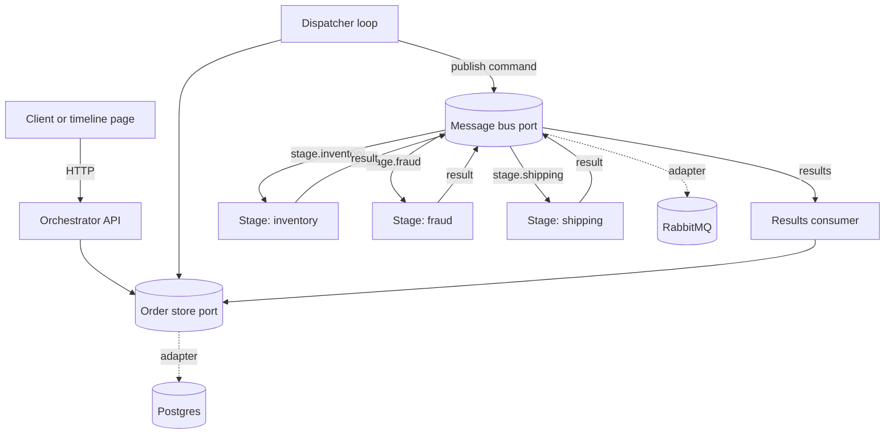
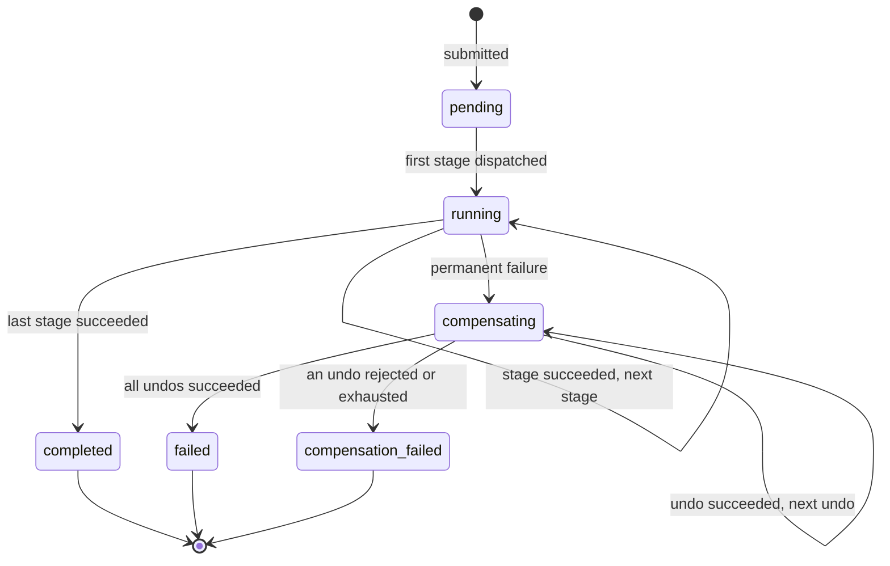

# Design record

How the order orchestrator is built and why. The planning record, with the full requirement list and acceptance examples, is [`docs/plans/2026-10-13-1425-feat-async-order-orchestrator-plan.md`](plans/2026-10-13-1425-feat-async-order-orchestrator-plan.md); the brief is [`brief.md`](brief.md). This file records the decisions, the alternatives that were rejected, and where the implementation refined the plan.

## Shape of the system

The orchestrator is the only process that reads or writes the database. Stages are stateless: a command carries everything a stage needs and a result carries everything it produced. Both external systems sit behind a port, with an in-memory adapter as the second implementation of each, so the state machine and the application run in unit tests with no infrastructure.

One attempt, from due to recorded:

1. The dispatcher claims a due order, inserts the attempt row with its deadline, advances the order, and commits, all in one transaction. Then it publishes the command.
2. The stage worker drops the command if its deadline has passed, acknowledges it, simulates an outcome, runs its handler, and publishes a result.
3. The results consumer settles the result against the open attempt, applies the transition, and sets the next due time, in one transaction.

A crash between the commit and the publish costs one attempt and one deadline window; the same sweep that recovers a silent stage recovers it. A publish the bus could not send, because its connection is down, costs nothing: the dispatcher releases the attempt it just opened (the row is deleted, since no one ever saw the command), makes the order due again at the next sweep, and releases the rest of the batch, so a broker outage never consumes the attempt cap. Any other publish error is ambiguous, since a broker can accept a message whose confirmation is then lost: that attempt keeps its identity and deadline, the sweep times it out, and a result for it that arrives later is stale, so an attempt number is never reused for a command a stage may hold. Releasing is a no-op when the attempt is no longer open. While the broker is down each sweep costs one publish timeout and releases its batch; the released orders are not due until the next interval, so the loop does not spin.

## State model

The transitions are a pure function, `transition(order, event, policy)`, that imports neither port. A test enumerates every edge the function can produce and fails if the set changes. A retry or a timeout does not change the state: it records the attempt and sets the next due time on the order, so a backoff survives a restart.

## Decisions and rejected alternatives

| Decision | Chosen over |
|---|---|
| Linear pipeline ordered by config; an order copies the stage list at submission | Per-order-type pipelines, conditional skips, a DAG: each multiplies the state model and the test surface, and no current stage needs them |
| An undo handler on every stage, default a no-op; a permanent failure undoes every dispatched stage in reverse, the failing stage included | No compensation; declaring undo-capable stages in orchestrator config, which would make the orchestrator know about stages |
| Own orchestrator over a message broker | Postgres as the queue (couples every stage to the schema); an off-the-shelf engine such as Temporal (the orchestration is the core of this system, so it stays in our code; see "Build or adopt the orchestrator" below) |
| RabbitMQ | Redis: losing a command or a result is unacceptable here, and RabbitMQ confirms a message only once it is on disk; Redis wins when latency comes first (see "Broker: RabbitMQ or Redis" below) |
| Order row plus an append-only attempt log | Event sourcing with a projection: the history the UI needs is the attempt log, and the event log adds fold and projection code for the same visible behaviour |
| One container per stage, built from one image, handler chosen by `STAGE_NAME` | One API container plus a worker pool (the separate services are the point); one image per stage (three Dockerfiles for identical code) |
| Postgres | SQLite: not safe for concurrent writers from separate processes over a shared volume |
| Stateless stage services | Stages reading the database |
| Required `Idempotency-Key` header; unique index; SHA-256 of canonical JSON for the comparison; 201 created, 200 replay, 409 mismatch | Server-generated ids with duplicates allowed; payload hashing as the key, which collides on legitimate identical orders |
| Observability is the attempt history and the timeline page | Structured logs with correlation ids and a metrics endpoint: out of scope for this version |
| One dispatcher loop that is also the sweep: it claims due orders and times out overdue attempts | Publishing inline after commit with a sweep as backstop (two dispatch paths to test); a transactional outbox (the open attempt row with its deadline already plays that role) |
| Ports and adapters for the bus and the store, in-memory adapters as the second implementation | Calling aio-pika and SQLAlchemy directly from the orchestrator |
| aio-pika 10.1.1, pinned exactly | Dramatiq (owns retries and attempt counting, which conflicts with the orchestrator owning them); FastStream (a decorator and injection layer over the same client); pika (not asyncio-native). 10.1.0 and 10.1.1 changed reconnect behaviour, so a test restarts the broker with a consumer already attached |
| A stage acknowledges before running its handler; the broker never retries; durable classic queues, no dead-letter exchange, no message TTL | Acknowledge after the handler (a second, uncounted retry path racing the dispatcher); quorum queues (a delivery limit and a consumer timeout, both competing retry authorities) |
| Closing an attempt is guarded: it applies only to an attempt that is still open, under the order's row lock | Trusting that results arrive once and in time |
| Pydantic models in one `contracts` package, shared by the orchestrator and the stage kit | Schema copies in each image, where drift becomes a dropped message |
| Pipeline config in TOML, read with `tomllib` and validated at startup | Environment variables, which do not express an ordered list with per-stage overrides |
| A static page with no build step, served by the orchestrator | A frontend toolchain |
| Three test layers: unit with in-memory adapters, contract tests per port run against every adapter, end-to-end against Compose | Mocking the broker and the database in the orchestrator tests |

## Build or adopt the orchestrator

Workflow engines that do this job exist, and the architect weighed them before deciding to build. The orchestration, the state model, and the attempt history are the core of this system, so they are kept in our own code: every rule is one pure function under unit test, the whole flow is readable in one place, and there is no second platform to run, upgrade, or learn. The cost is that we own retry, timeout, and compensation logic an engine would provide, and the system runs as one orchestrator instance. The decision is revisited when any of these becomes true: more than one orchestrator instance is needed, there are several workflow types, workflows wait on people for hours or days, or running workflows must survive a change to their own code.

| Kind | Examples | Fit for this workflow |
|---|---|---|
| Durable-execution engines | Temporal (Python SDK), Cadence, Restate, DBOS, Hatchet, Inngest | Closest match. The workflow is plain code; the engine persists every step, retries, enforces timeouts, and survives restarts. Sagas with compensation are a documented pattern |
| Workflow engines with a modelled flow | Camunda/Zeebe, Netflix Conductor (Orkes), AWS Step Functions, Azure Durable Functions | The same guarantees, with the flow defined as a diagram or JSON instead of code. The cloud services tie the system to one provider |
| Task queues with chaining | Celery chains and chords, Dramatiq pipelines | Steps run in sequence, but there is no durable per-order state, no compensation, and no history; what this repository builds would still be needed on top |
| Saga frameworks | MassTransit, NServiceBus (.NET), Axon (Java) | Good saga support, outside the Python stack |
| Data pipelines | Airflow, Prefect, Dagster | Built for scheduled batch jobs, not one workflow per incoming order |

If the decision flips, Temporal is the first candidate, and each part of this design has a direct counterpart:

| This design | Temporal equivalent |
|---|---|
| Order row plus append-only attempt log | Workflow event history |
| Dispatcher sweep, due times, deadlines | Durable timers and activity timeouts |
| `max_attempts` and backoff in `config/pipeline.toml` | Activity retry policy |
| Undo of every dispatched stage in reverse | Saga compensation in workflow code |
| Guarded close that drops a stale result | Built in: a late activity result is never applied |
| Timeline page | Temporal Web UI |

What Temporal would cost: a Temporal cluster and its database to operate (or Temporal Cloud), deterministic workflow code with explicit versioning rules when the workflow changes, and the orchestration logic moving from readable application code into the engine's behaviour. The pure `transition` function and its tests would remain the specification of the workflow.

## Broker: RabbitMQ or Redis

| | RabbitMQ (chosen) | Redis |
|---|---|---|
| Right choice when | losing a message is unacceptable | latency is the top priority |
| When a publish is confirmed | for a persistent message on a durable queue, only after it is written to disk | as soon as it is in memory; written to disk afterwards, unless `appendfsync always` is set, which Redis's documentation calls very slow |
| On a broker crash | confirmed messages survive | with AOF fsync every second (the recommended setting), up to one second of acknowledged writes is lost; with RDB snapshots alone, minutes |
| Latency | a confirm can take a few hundred milliseconds under load, because writes to disk are batched | sub-millisecond |
| Work-queue model | durable queues, competing consumers, acknowledgements, and a management view out of the box | Streams provide consumer groups, `XACK`, and `XAUTOCLAIM`; group layout, recovery, and trimming are left to the application |

This system is in the first column. A lost command or result costs the order a full attempt and a deadline window before the sweep notices, and a lost result may hide work a stage already did, which then has to be undone. Commands are a few per order and each stage takes hundreds of milliseconds, so the broker's confirm latency is not on the critical path. Redis is the right choice for a system that needs the lowest latency and can tolerate losing the last second of messages, such as caching, live notifications, or rate limiting. The bus port keeps the choice open: a Redis Streams adapter would run the same bus contract suite.

## Where the implementation refined the plan

- **The store port is atomic where the plan listed separate steps.** `claim_due`, `claim_overdue`, and `settle` each take a pure callback and apply its decision together with the attempt row, in one transaction in a database adapter. This replaces the plan's separate `open_attempt`, `close_attempt`, and `apply_decision`: a crash between those steps would leave an order with no due time and no open attempt, which no sweep could recover. `settle` takes a blocking row lock where the plan named `SKIP LOCKED`, so a result waits for a concurrent timeout of the same order and is then dropped as stale, instead of being skipped and lost to a transient lock.
- **A result that arrives after its attempt's deadline counts as a timeout**, even if the sweep has not marked the attempt yet. Without this, the history depended on where the sweep interval fell against the deadline, and the timeout scenario was not reproducible.
- **`compensating` to `compensating` is an edge**: the next undo, or an undo retry. The plan's diagram does not draw it.
- **`next_attempt_due_at` is exposed only while an order waits to retry**, meaning its latest attempt is `retry` or `timed_out`. After a stage succeeds the next stage is due at once, and showing a due time then would flash a retry banner on every stage change.
- **The consumer restart loop is shared.** `consume_forever` in the bus package logs a failing handler and carries on, and reopens a stream that fails, so neither the results consumer nor a stage runner can die silently. An error from the handler acknowledges that message and leaves the attempt to its deadline. A command dropped because its deadline passed is logged by the stage, so a discarded attempt is visible in `docker compose logs`.
- **Submission body** is `{"payload": {...}, "script": {...}}`. Payload and script together are what the idempotency comparison hashes.
- **The in-memory adapters run the same contract suite as the real ones.** The in-memory runs stay in the no-Docker unit command; only the Postgres and RabbitMQ runs carry the `contract` marker.
- **Boundary checks added where the plan was silent**: the `Idempotency-Key` header is at most 255 characters, a request body is at most 64 KiB, counted as the bytes arrive rather than taken from `Content-Length` (the payload is copied into every command), a script lists at most `max_attempts` tokens per stage and kind, and `STAGE_NAME` must be a lowercase identifier because it becomes a module name and a queue name.
- **Status is one snapshot.** The order and its attempts are read in one `REPEATABLE READ` transaction, so a poll never shows a state from before a settle next to history from after it, and the order payload is read once rather than once per attempt.
- **A replay is judged against the stored order.** An existing key is compared with its stored submission before the script is checked against today's pipeline, so lowering a cap or removing a stage never turns a replay into a 422. The timeline page keeps one key per submitted body, so retrying after a lost response finds the same order.
- **A never-sent attempt is released, not counted.** The attempt log is append-only once a command may have left the orchestrator; only an attempt the bus proves it never sent is removed, and the order is due again at the next sweep.
- **The dispatcher ticks again at once after a full batch**, so a backlog drains at the store's pace instead of 50 orders per sweep interval.
- **The schema checks its enums.** `state`, `current_kind`, `kind`, and `outcome` carry CHECK constraints, so a bad write is rejected instead of surfacing as a failed read.
- **The claim and timeout batches are atomic.** One failing callback rolls back the whole batch and the next sweep retries it; the state machine's guards make such a failure unreachable today, and this note is the reminder if a new event changes that.
- **`gift_wrap` ships in the stage image** although only the end-to-end suite uses it: the "add a stage" test is then a real handler module, a Compose service, and a config line, and nothing else.

The plan document is left as written; this file is the current record.

## Acceptance examples and the tests that cover them

Every acceptance example runs through the real orchestrator code against in-memory adapters, and the ones observable through the API also run end to end against the Compose stack. Test names are in `services/orchestrator/tests`, `packages/*/tests`, `services/stage/tests`, and `tests/`.

| Example | Unit level | End to end |
|---|---|---|
| AE1 same key, same payload | `test_api::test_resubmitting_the_same_key_and_payload_returns_the_original_order` | `test_acceptance::test_resubmitting_a_key_returns_the_order_and_a_changed_payload_is_a_conflict` |
| AE2 retries then success | `test_transitions::test_two_retries_then_success_advance_to_the_next_stage` | `test_acceptance::test_scripted_transient_failures_are_retried_until_the_stage_succeeds` |
| AE3 exhaustion, undo, failed | `test_transitions::test_exhausting_the_first_stage_undoes_that_stage_then_fails` | `test_acceptance::test_a_stage_that_exhausts_its_attempts_is_undone_and_the_order_fails` |
| AE4 rejection, reverse undo | `test_transitions::test_rejection_undoes_the_failing_stage_then_earlier_stages_in_reverse`, `test_results::test_a_rejection_undoes_the_stages_in_reverse_and_the_order_fails` | `test_acceptance::test_a_rejection_undoes_the_failing_stage_then_the_earlier_ones_in_reverse` |
| AE5 failing undo | `test_transitions::test_undo_that_keeps_failing_ends_in_compensation_failed`, `test_results::test_an_undo_that_keeps_failing_ends_in_compensation_failed` | `test_acceptance::test_an_undo_that_keeps_failing_ends_in_compensation_failed` |
| AE6 late result ignored | `test_dispatcher::test_an_attempt_past_its_deadline_is_timed_out_and_its_late_result_is_dropped`, `test_results::test_a_result_after_its_deadline_counts_as_a_timeout_before_the_sweep_runs` | `test_acceptance::test_a_stage_that_answers_after_its_deadline_is_timed_out_and_retried` |
| AE7 orchestrator restart mid-execute | `test_lifespan::test_the_running_service_dispatches_and_advances_an_order_on_its_own` | `test_restarts::test_an_order_survives_an_orchestrator_restart_while_an_execute_is_outstanding` |
| AE8 a new stage | `test_handlers::test_the_stage_name_selects_its_handler_module` | `test_restarts::test_a_new_stage_needs_only_a_handler_a_compose_service_and_a_config_line` |
| AE9 duplicate stage fails startup | `test_config::test_a_duplicate_stage_is_rejected_and_named`, `test_lifespan::test_startup_fails_when_the_pipeline_names_a_stage_twice` | not reachable through the API |
| AE10 crash before the first dispatch | `test_dispatcher::test_a_due_order_is_dispatched_by_one_tick`, `test_dispatcher::test_an_order_is_not_dispatched_before_the_pending_threshold_passes` | not reachable through the API |
| AE11 same key, other payload | `test_api::test_reusing_a_key_with_another_payload_is_a_conflict_and_changes_nothing` | the same end-to-end test as AE1 |
| AE12 restart during a backoff | `test_dispatcher::test_a_retry_waits_for_its_backoff_before_the_next_attempt` | `test_restarts::test_a_retry_waiting_out_its_backoff_is_dispatched_after_an_orchestrator_restart` |
| AE13 duplicate delivery | `test_results::test_the_same_result_delivered_twice_advances_the_order_once`, `test_runner::test_the_same_command_delivered_twice_calls_the_handler_twice_with_one_identity` | not reachable through the API |
| AE14 stage down across timeouts | `test_bus_contract::test_expired_commands_are_dropped_and_the_live_one_is_delivered` (both adapters) | `test_acceptance::test_only_the_live_attempt_runs_when_a_stage_comes_back_after_timeouts` |
| AE15 config change mid-order | `test_results::test_an_order_finishes_on_the_stage_list_it_was_submitted_with` | `test_restarts::test_an_order_in_flight_keeps_its_stage_list_when_the_pipeline_config_changes` |
| AE16 restart mid-undo | `test_results::test_an_undo_outstanding_across_a_restart_is_retried_and_the_order_fails` | `test_restarts::test_a_compensating_order_survives_an_orchestrator_restart_while_an_undo_is_outstanding` |

## Limits

Deliberately out of this version: more than one orchestrator instance (the dispatcher loop and the results consumer are not safe to replicate), authentication, structured logs and metrics, a manual retry or resume for terminal orders, conditional or parallel stages, and Redis and SQLite adapters. The ports exist, so the adapters are an addition, not a rewrite.

Known and accepted: a store error while a result is being settled acknowledges that result, so the attempt waits for its deadline and the retry counts against the cap. Routing infrastructure errors to a requeue instead needs a negative-acknowledge path through the bus port and a guard against a poison result looping forever; neither is built. The retry policy is read from the current config at use, not snapshotted with the stage list, so a config change mid-order changes an in-flight order's budget.

## Consistency, concurrency, and load

| Requirement | Guarantee | Ceiling |
|---|---|---|
| R7, R23 delivery | At-least-once commands and results; effectively-once settlement through the guarded close | A stage crash mid-handler loses the command until its deadline; a duplicate command runs the idempotent handler twice |
| R8 durability | Attempt row and order update in one transaction; the due time is on the row | One Postgres node, no replication |
| R9, R26 submission | Linearizable per key (unique constraint, re-read on the losing insert); canonical-JSON hash for replay versus conflict | Replay is judged against the stored order, not today's config, and returns the current state; keys never expire; body at most 64 KiB counted as received; script at most `max_attempts` tokens per stage and kind |
| R11, R22 retry and recovery | Backoff persisted; the sweep recovers due orders and overdue attempts every `interval_seconds` | Recovery latency is one interval plus one deadline window; a lost publish and a dead stage look the same to the sweep |
| R15, R16 status | One `REPEATABLE READ` transaction, one snapshot | Served from the primary, polled once a second per page |
| R5 queues | One durable queue per stage; stages run concurrently across orders and in sequence within one | A stage container handles about 1 / latency commands per second with prefetch 1; stage services scale by replicas |
| Orchestrator concurrency | Two asyncio loops in one process, serialized per order by row locks (`SKIP LOCKED` claims, blocking `settle`) | One result at a time (about 1 / settle latency per second); batches of 50 claims, re-ticked at once while full; one instance only |
| Load amplification | The submission travels in every command | Payload x stages x attempts x 2 bytes on the bus at worst, bounded by the body cap; per-order history bounded at stages x `max_attempts` x 2 rows; no retention |
| Clocks | Absolute deadlines compared on the stage's clock | Containers share a clock; skew beyond the 10 ms margin breaks the scripted timeout |
| Availability | Submission needs the database only | Orders accepted during a broker outage wait at no cost to their attempt budget while the bus reports itself down; a publish with a lost confirmation counts, since the stage may run it |
