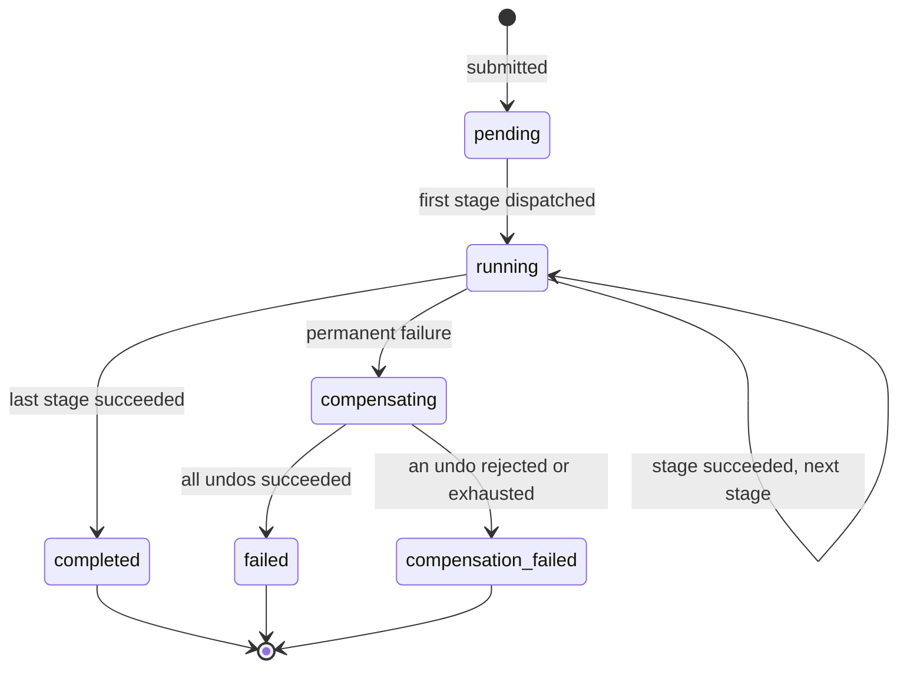
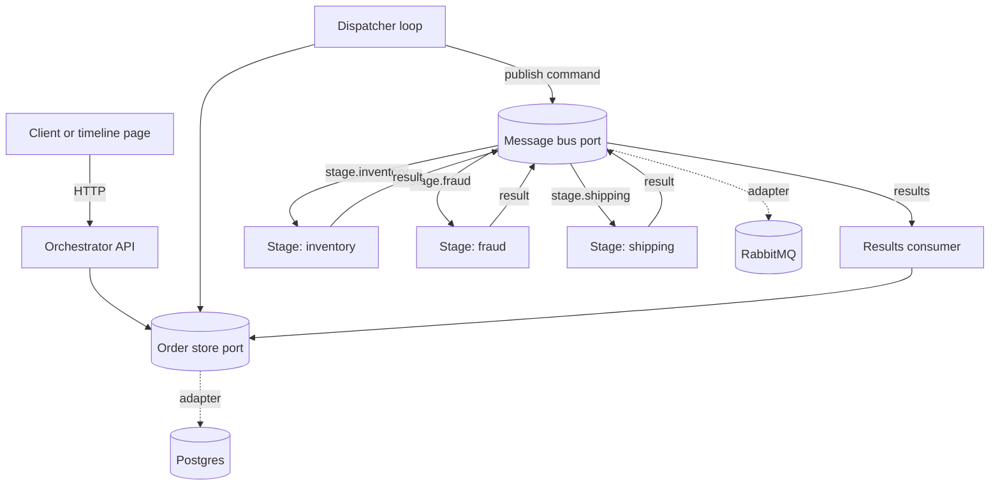
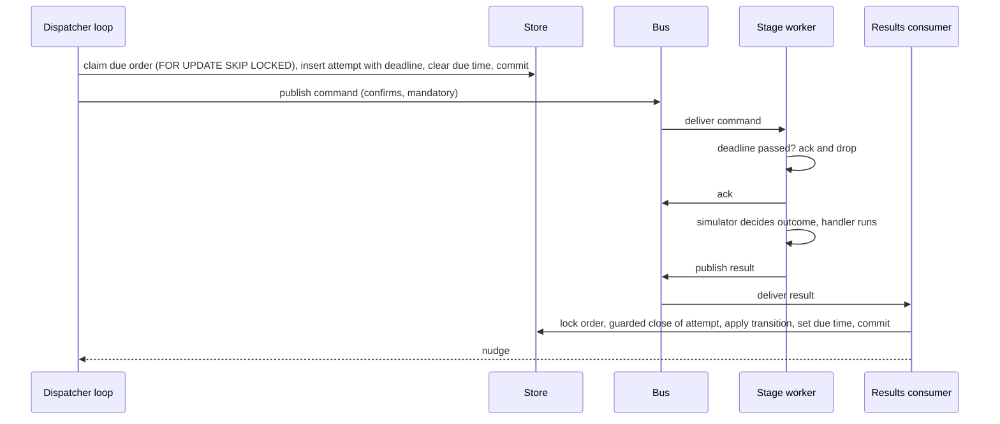

# Asynchronous Order Orchestrator - Plan

## Goal Capsule

- **Objective:** An order submitted through the REST API is processed through a configurable sequence of slow, intermittently failing stages, and anyone querying the order sees exactly where it is and how it got there, until it lands in a terminal state.
- **Means:** An orchestrator service owning order state behind a store port drives a config-ordered linear pipeline over a message-bus port, with RabbitMQ and Postgres as the shipped adapters (KTD1). Each stage is a stateless container built from one stage-kit package.
- **Product authority:** The brief at `docs/brief.md`, then the Product Contract below, then the Planning Contract. Hard constraints from the brief: Python, REST submit and status, asynchronous inter-service communication, Docker Compose, small and well-tested over sprawling.
- **Execution profile:** Greenfield monorepo. Every unit lands with its tests. Unit tests need no Docker; contract and end-to-end tests need Docker.
- **Stop conditions:** Stop and ask if a settled decision proves infeasible, if a pinned dependency cannot be installed on Python 3.14, or if the end-to-end suite cannot be made deterministic with the outcome script.
- **Who finishes:** The implementer completes all nine units, the Verification Contract passes, and the Definition of Done holds. The design record under `docs/` is updated when a decision changes during implementation.
- **Product Contract preservation:** changed: R13 and R14 (undo now covers the failing stage as well as completed stages, chosen in planning dialogue); R15 (current stage exposed in `compensating` too); AE3, AE4, AE13 reworded to match; AE16 added. Outstanding Questions resolved in place into KTD2, KTD4, KTD11, KTD13.

---

## Product Contract

### Summary

Build an orchestrator service plus a base stage-service template, both in Python, wired through RabbitMQ with Postgres as the single store of order state. Stages are declared in config as an ordered list, and a new stage is a handler plus a config entry plus a Compose service. A status endpoint returns the order's current state and full attempt history, and a small polling page renders it as a timeline.

### Problem Frame

An order pipeline is a sequence of calls to systems that are slow and fail without warning: inventory, fraud scoring, carrier label generation. A synchronous request path cannot survive that. The real work is in what happens between the stages: deciding when a failure is worth retrying, when it is final, what to unwind when a later stage rejects an order that earlier stages already acted on, and how a person finds out any of this for a specific order.

The evaluation targets that middle layer. The stage logic is simulated on purpose, so the orchestration, the state model, and the observability of the workflow are what get judged. The brief also asks that the set of stages be easy to change over time, so the pipeline shape cannot be hard-coded into the coordinator.

### Key Decisions

- **Linear pipeline, ordered by config.** The orchestrator reads an ordered list of stage names at startup. Appending, removing, or reordering a stage is a config edit. (session-settled: user-directed — chosen over per-order-type pipelines, conditional skips, and a full DAG: those multiply the state model and test surface, and none is needed for the current stages.) Governs R1, R2, R3, R24.
- **Compensation hooks are built now.** Every stage has an undo handler, and the base template's default undo is a no-op that reports success. On permanent failure the orchestrator runs the undo of every dispatched stage in reverse order. (session-settled: user-directed — chosen over no compensation: the user wants the saga path present and tested even though simulated stages have no real side effects. The always-present undo was chosen over a per-stage declaration in orchestrator config: the orchestrator then needs no knowledge of which stages can undo.) Governs R13, R14.
- **Own orchestrator over a message broker.** The orchestrator service holds the state machine and publishes one command per stage to a RabbitMQ queue named for that stage. Stage services consume, run the handler, and publish a result. (session-settled: user-directed — chosen over Postgres-as-queue, which couples every stage service to the database schema, and over Temporal, which would implement the orchestration and state management the brief says it is evaluating.) Governs R5, R6, R7.
- **RabbitMQ over Redis Streams.** (session-settled: user-approved — chosen over Redis Streams: native acknowledgement, redelivery, and dead-lettering mean less retry plumbing to write and test.) Governs R5. Planning conflict call-out: the final design uses manual acknowledgement, prefetch, durable queues, and publisher confirms, and deliberately does not use broker redelivery or dead-lettering (KTD4). Ack control and durable queues remain the reason RabbitMQ beats Redis Streams; the decision stands.
- **Order row plus append-only attempt log.** The order row carries the current state and current stage. Every execute and undo attempt appends a row. State transitions are an explicit table in code, enforced at write time. (session-settled: user-approved — chosen over an event-sourced log with a projection: the history the UI needs comes from the attempt log, and the event log adds fold and projection code for the same visible behaviour.) Governs R8, R15, R16.
- **One container per stage, from one template.** Each stage runs as its own service. All stage services are built from one base package that owns the broker consumer, the result publisher, the failure simulator, and the handler contract. (session-settled: user-directed — chosen over one API container plus one worker pool: the user wants the reviewer to see separate services communicating asynchronously.) Governs R4, R18.
- **Postgres, not SQLite.** Several containers share order state. SQLite over a shared volume is not safe for concurrent writers from separate processes. Governs R8.
- **Stage services are stateless.** Only the orchestrator reads or writes the database. A stage service receives everything it needs in the command and returns everything in the result. Governs R6, R23.
- **Client idempotency key on submission.** A resubmitted order with the same key returns the existing order and does not start a second pipeline run. (session-settled: user-approved — chosen over server-generated ids with duplicates allowed, and over payload hashing, which collides on legitimate identical orders.) Governs R9, R26.
- **Observability is the attempt history and the timeline page.** Structured logs and metrics are deferred. (session-settled: user-directed — chosen over structured logs and a metrics endpoint: the user limited this version to stage history in the status API and the UI.) Governs R15, R16, R17, R27, R28.
- **One stuck-order sweep covers both lost dispatches and silent stages.** Every dispatched command carries a deadline. A periodic sweep in the orchestrator treats any order whose dispatched command has passed its deadline without a result as a transient failure of that attempt. When an attempt is recorded as `retry` or `timed_out`, the orchestrator persists the next attempt's due time on the order instead of holding the backoff wait in memory, and the sweep dispatches any order whose due time has passed with no command outstanding. The same sweep dispatches any order left in `pending` past a threshold. This covers a crash before the first dispatch, a crash between saving state and publishing, a crash while waiting out a backoff interval, and a stage that never answers, with one mechanism. Governs R11, R22, R25.

### Actors

- A1. **Client** — submits orders and polls status. In this version the client is the timeline page or a test harness. No authentication.
- A2. **Orchestrator** — the service that owns order state, dispatches stage commands, applies retry and compensation rules, and serves the REST API.
- A3. **Stage service** — one container per stage, built from the base template. Executes a stage command or an undo command and reports the outcome.
- A4. **Operator** — a person reading the status endpoint or the timeline page to find out where an order is and why.

### Requirements

**Pipeline composition**

- R1. The orchestrator builds the pipeline from an ordered list of stage names supplied in config at startup.
- R2. Adding, removing, or reordering a stage requires no change to orchestrator code.
- R3. The orchestrator fails to start when the pipeline config is empty or names a stage twice.
- R4. A new stage is created by implementing the handler contract on top of the base stage-service template and adding one Compose service.
- R23. Execute and undo handlers are idempotent for a given order id and stage, which the template passes to the handler, because delivery is at least once and a timed-out attempt is retried while the earlier attempt may still be running.
- R24. The orchestrator copies the configured ordered stage list onto the order at submission and drives dispatch, next-stage selection, and reverse-order compensation from that copy, so a config change affects only orders submitted after restart.

**Dispatch and delivery**

- R5. Each stage has its own command queue, and the orchestrator publishes one command per stage attempt to that queue.
- R6. A command carries the order id, the stage name, the attempt number, the command kind (execute or undo), the dispatch deadline, and the order payload. A result carries the same identifiers plus the outcome and an optional stage output. An undo command additionally carries the stage output of the execute attempt it reverses.
- R7. Delivery is at least once. The orchestrator ignores a result whose order, stage, attempt, and kind do not match the attempt it is waiting on.
- R8. Order state and the attempt log live in Postgres and survive restart of any service.
- R25. The base stage-service template acknowledges and discards, without running the handler, any command whose deadline has already passed.

**Submission**

- R9. Submission accepts a client-supplied idempotency key. A second submission with the same key and the same payload returns the existing order and starts no new work.
- R10. Submission returns the order id and the initial state before any stage runs.
- R26. A submission with an already used idempotency key and a different payload is rejected with a conflict error and starts no new work.

**Retry and failure**

- R11. A stage attempt that reports a transient failure, or whose dispatch deadline passes without a result, is retried with backoff up to a per-stage attempt cap. Exhausting the cap is a permanent failure. The backoff wait is persisted as a next-attempt due time on the order and survives restart.
- R12. A stage attempt that reports a permanent rejection is a permanent failure with no further retries of that stage.
- R13. On permanent failure, the orchestrator runs the undo handler of every stage that was dispatched for the order, the failing stage included, in reverse pipeline order, with the same retry rules as execute. A stage that overrides nothing runs the template's default undo, which does no work and reports success.
- R14. When every undo succeeds, the order ends in `failed`. When an undo reports a permanent rejection or exhausts its attempts, the order ends in `compensation_failed` and no further undo runs. Both are terminal, and neither is recovered automatically.

**Status and observability**

- R15. Status returns the order's current state, the current stage when running or compensating, the next attempt's due time when waiting to retry, and the terminal reason when finished.
- R16. Status returns the full attempt history in order: stage, kind, attempt number, outcome, reason, started and finished timestamps. Outcome is one of `succeeded`, `retry`, `timed_out`, `rejected`, `exhausted`. A successful attempt's stage output is included when present.
- R17. A single-page UI submits an order, polls its status, and renders the attempt history as a timeline until the order reaches a terminal state.
- R27. The page addresses an order by its id in the URL: submission redirects to that URL, opening the page without an id shows the submit form, and an unknown id shows a not-found message.
- R28. The timeline renders an attempt with no finished timestamp as in progress, shows the order as waiting to retry between a failed attempt and the next dispatch, marks undo attempts distinctly, and on a failed poll keeps the last rendered timeline with a connection notice and keeps polling.

**Simulation and testability**

- R18. Each stage service has a configurable failure profile: latency range, transient failure probability, and permanent rejection probability.
- R19. An order may carry a per-stage outcome script that overrides the stage's profile, so a test can force a specific sequence of outcomes deterministically.
- R20. The state machine and transition rules are unit-testable without a broker or a database.
- R21. One Compose command brings up the whole system, and an end-to-end test drives it through the API alone.

**Recovery after crash**

- R22. An order that stays in `pending` past a configured threshold is dispatched to its first stage by the orchestrator's sweep.

### Key Flows

- F1. Happy path
  - **Trigger:** A1 submits an order.
  - **Actors:** A1, A2, A3
  - **Steps:** A2 stores the order in `pending`, moves it to `running` at the first stage, and publishes an execute command. The stage service runs the handler and publishes success. A2 records the attempt and advances to the next stage. After the last stage succeeds, A2 moves the order to `completed`.
  - **Covered by:** R1, R5, R6, R8, R10, R15, R16

- F2. Transient failure with retry
  - **Trigger:** A stage reports a transient failure, or its deadline passes.
  - **Actors:** A2, A3
  - **Steps:** A2 records the attempt as `retry` when it reported a transient failure, or as `timed_out` when its deadline passed, records the next attempt's due time, and when it is due publishes a new command with the next attempt number. A late result from the earlier attempt is ignored. Once an attempt succeeds, F1 resumes.
  - **Covered by:** R7, R11

- F3. Permanent failure with compensation
  - **Trigger:** A stage reports a permanent rejection, or exhausts its attempt cap.
  - **Actors:** A2, A3
  - **Steps:** A2 records the terminal reason and moves the order to `compensating`. For each dispatched stage, starting with the failing one and walking back, A2 publishes an undo command and waits for its result, applying R11 retry rules. When all undos succeed, the order moves to `failed`. When an undo is rejected or exhausts its attempts, the order moves to `compensation_failed`.
  - **Covered by:** R12, R13, R14

- F4. Operator inspection
  - **Trigger:** A4 opens the timeline page or calls status.
  - **Actors:** A4, A2
  - **Steps:** A2 returns the current state and the attempt history. The page polls until the state is terminal and renders each attempt in order.
  - **Covered by:** R15, R16, R17



### Acceptance Examples

- AE1. **Covers R9.** Given an order was submitted with idempotency key `k1`, when the same key is submitted again with the same payload, then the response carries the original order id and the attempt history shows no additional attempts.
- AE11. **Covers R26.** Given an order was submitted with idempotency key `k1`, when the same key is submitted again with a different payload, then the response is a conflict error and no order is created or changed.
- AE2. **Covers R11, R16.** Given a stage attempt cap of 3 and an outcome script of two transient failures then success for `fraud`, when the order runs, then the history shows `fraud` attempts 1 and 2 as retry, attempt 3 as succeeded, and the order proceeds to the next stage.
- AE3. **Covers R11, R13, R14.** Given an attempt cap of 3 and an outcome script of three transient failures for `inventory`, when the order runs, then `inventory` attempt 3 is recorded as `exhausted`, the `inventory` undo succeeds, and the order ends in `failed`.
- AE4. **Covers R12, R13, R14.** Given `fraud` is scripted to reject, when the order runs, then the history shows `inventory` execute succeeded, `fraud` execute rejected, `fraud` undo succeeded, `inventory` undo succeeded, and the order ends in `failed` with the rejection reason.
- AE5. **Covers R13, R14.** Given AE4's setup and the `inventory` undo scripted to fail transiently on every attempt, when the order runs, then the undo is recorded as exhausted and the order ends in `compensation_failed`.
- AE6. **Covers R7, R11.** Given a stage is scripted to delay past the dispatch deadline on attempt 1 and succeed on attempt 2, when attempt 1's late result arrives after attempt 2 was dispatched, then the late result is ignored and the history shows attempt 1 as timed out and attempt 2 as succeeded.
- AE7. **Covers R8, R22.** Given an order is `running` with a command dispatched, when the orchestrator restarts before the result arrives, then the order resumes from the same stage after restart and the attempt history is intact.
- AE8. **Covers R2, R4.** Given a new stage service is added with a handler and a Compose entry and the config list is extended with its name, when the system starts and an order runs, then the new stage executes in its configured position with no orchestrator code change.
- AE9. **Covers R3.** Given the pipeline config names a stage twice, when the orchestrator starts, then it exits with an error naming the duplicate.
- AE10. **Covers R22.** Given an order was stored in `pending` and the orchestrator crashed before dispatching the first stage, when the orchestrator restarts and the pending threshold passes, then the first stage is dispatched and the order proceeds as in F1.
- AE12. **Covers R11.** Given an attempt was recorded as `retry` with a next-attempt due time, when the orchestrator restarts before that time and the time then passes, then the next attempt is dispatched and the order proceeds.
- AE13. **Covers R23, R7.** Given a stage command is delivered twice for the same attempt, when both deliveries are processed, then the handler is called twice with identical identifiers, the history records one attempt, and the order advances once.
- AE14. **Covers R25.** Given a stage service is down while attempts 1 and 2 of its stage time out, when the service recovers with those commands still queued, then it discards attempts 1 and 2 without running the handler and executes only the attempt that is still live.
- AE15. **Covers R24.** Given an order is `running` at stage `fraud`, when `fraud` is removed from the pipeline config and the orchestrator restarts, then the order completes on its original stage list and a newly submitted order skips `fraud`.
- AE16. **Covers R8, R13, R15.** Given an order is `compensating` with the `fraud` undo done and the `inventory` undo dispatched, when the orchestrator restarts before the result arrives, then status shows `compensating` at `inventory`, the undo is retried after its deadline, and the order ends in `failed`.

### Success Criteria

- The three simulated stages run end to end from one Compose command with no manual steps.
- Every state transition in the diagram above is covered by a unit test that fails if the transition table changes.
- Every acceptance example above runs as an automated test against the real orchestrator code, with the broker and database replaced by in-memory adapters at unit level and real in the end-to-end suite.
- A reader of the attempt history can reconstruct what happened to an order without reading logs.
- `docs/` carries the design record: every key decision in this plan with its rejected alternatives, kept current as planning and implementation refine them.

### Scope Boundaries

Deferred for later, each named as an extension point in the design:

- Conditional stage skipping, parallel stages, and per-order-type pipelines.
- Structured logging with correlation ids, and a metrics endpoint.
- A manual retry or resume endpoint for `failed` and `compensation_failed` orders.
- Event-sourced history with projections.
- Authentication and authorisation on the API.
- Health and readiness endpoints beyond the Compose healthchecks.
- Real stage logic. Stages stay simulated.
- Redis and SQLite adapters. The ports exist (KTD1); only RabbitMQ, Postgres, and in-memory adapters are built.
- Running more than one orchestrator instance.

Considered and not built:

- Gating the outcome script behind a simulation-mode flag. Every caller is trusted in this version and stages are simulated, so an ungated script harms nothing; the flag earns its place when the first real stage lands.
- A dead-letter exchange. The orchestrator owns retries and the attempt row is the record of exhaustion, so nothing would ever be dead-lettered (KTD4).
- A transactional outbox table. The open attempt row with its deadline already plays that role and the dispatcher loop is the relay (KTD3).

### Dependencies / Assumptions

- Postgres and RabbitMQ run as Compose services alongside the orchestrator and the stage services.
- The simulated stages have no real side effects, so undo handlers are exercised only through the failure simulator.
- Callers are trusted. The API has no authentication in this version.
- Exactly one orchestrator instance runs. The dispatcher loop and the results consumer are not safe to replicate in this version.
- Containers share the host clock, so an absolute deadline set by the orchestrator can be compared against the stage service's own clock.

---

## Planning Contract

### Key Technical Decisions

- KTD1. **Ports and adapters for the bus and the store.** The orchestrator depends on two protocols: a message bus (publish command, consume results) and an order store (create, claim due work, record outcomes, read status). The stage kit depends on the bus only (consume commands, publish result). The bus port and its adapters live in a shared `packages/bus` package because both the orchestrator and the stage kit consume them; the store port and its adapters live in the orchestrator because nothing else uses them. Shipped adapters: RabbitMQ and Postgres. In-memory adapters for both are the second implementation of each port and are what unit tests run against. Adapter choice is config. (session-settled: user-directed — chosen over calling aio-pika and SQLAlchemy directly from the orchestrator: the user wants RabbitMQ and Postgres swappable for Redis or SQLite without touching orchestration code.) Governs R5, R6, R7, R8, R20.
- KTD2. **aio-pika 10.1.1 is the RabbitMQ adapter's client.** It is asyncio-native, exposes manual ack, prefetch, publisher confirms, and `mandatory` returns, and hides no retry or state. Dramatiq rejected because it owns retries and attempt counting, which conflicts with R11; FastStream rejected as a decorator and dependency-injection layer over the same client; pika rejected as not asyncio-native. Pinned exactly: 10.1.0 and 10.1.1 changed reconnect and consumer-restore behaviour, so an end-to-end test restarts the broker (U9).
- KTD3. **One dispatcher loop; transitions only write rows.** A transition commits the new state plus a due time on the order row. The dispatcher loop is the sweep the Product Contract's Key Decision names; the two words mean one task. It is nudged by an in-process event after each commit and otherwise polling at the configured interval, claims orders whose due time has passed with no open attempt, inserts the attempt row with its deadline, commits, then publishes. The same loop marks open attempts past their deadline as `timed_out` and sets the next due time. A crash between commit and publish costs one attempt and one deadline window; accepted. Chosen over publishing inline after commit with the sweep as backstop, which is two dispatch paths to test, and over an outbox table, which this design already has in the attempt row. Governs R11, R22.
- KTD4. **Stage worker acks before the handler; the broker never retries.** Manual ack mode, prefetch 1, deadline check, ack, then handler, then result publish. Chosen over ack-after-handler because the orchestrator already owns attempts and deadlines; broker redelivery would be a second, uncounted retry path racing the dispatcher. Consequences: no dead-letter exchange, no message TTL, durable classic queues (quorum queues add a delivery limit and consumer timeout, both competing retry authorities). The orchestrator declares every stage queue and the results queue at startup so a publish to a stage with no consumer waits in the queue and is recovered by deadline instead of failing as unroutable. Publishes use publisher confirms with `mandatory` and raise on return. One connection per process, separate channels for publishing and consuming. Governs R5, R25.
- KTD5. **Attempt close is a guarded write.** Closing an attempt is an update on `(order_id, stage, kind, attempt)` where `finished_at IS NULL`, inside a transaction that locked the order row with `FOR UPDATE SKIP LOCKED`. Zero rows updated means the result is stale and is dropped. This is the R7 mechanism, and it serialises the dispatcher's timeout path against a live result for the same attempt in one asyncio process. Governs R7.
- KTD6. **The state machine is a pure module.** `transitions` holds the explicit table from the Product Contract diagram and a function from (order snapshot, event) to (new order fields, attempt rows to write, commands to enqueue). It imports neither port. Every edge in the diagram is one test. Governs R20.
- KTD7. **Schema.** `orders`: id, idempotency key (unique), payload, payload hash, stage list snapshot, state, current stage, current kind, next due at, terminal reason, timestamps. `attempts`: order id, stage, kind, attempt number, outcome (nullable until closed), reason, stage output, deadline at, started at, finished at; unique on `(order_id, stage, kind, attempt)`. Attempt numbers restart at 1 per `(order, stage, kind)`, so undo attempts are numbered independently of execute attempts. One Alembic migration, applied by the orchestrator entrypoint before the app starts. Governs R8, R15, R16.
- KTD8. **One uv workspace with a shared `contracts` package.** Command, result, outcome enum, and outcome script are Pydantic models in `packages/contracts`, imported by both the orchestrator and the stage kit, so schema drift between images is a build failure, not a dropped message. Governs R6.
- KTD9. **One stage image, handler chosen by `STAGE_NAME`.** The stage kit is a package with the consumer loop, the simulator, and the handler protocol (`execute`, `undo`, both async, both receiving order id, stage, attempt, payload, and script). Handlers for `inventory`, `fraud`, and `shipping` live in `services/stage/handlers/`. Each Compose stage service runs the same image with a different `STAGE_NAME`. Default `undo` returns success and does nothing. Chosen over one image per stage: three Dockerfiles for identical code. Governs R4, R13, R23.
- KTD10. **Simulator semantics.** The outcome script is keyed by `(stage, kind, attempt)`; tokens are `succeed`, `retry`, `reject`, `timeout` (sleep until the deadline has passed, then report success). Attempts a script leaves unlisted for a listed stage succeed; stages absent from the script use their profile. The script is validated at submission against the snapshotted stage list and rejected with 422 on an unknown stage or token. The script is part of the payload for R26 comparison and travels in every command. Profiles come from stage-service environment. All waits use `asyncio.sleep` so heartbeats are never starved. A handler exception is reported as `retry` with the exception class name as reason. A deadline that passes on the final allowed attempt is recorded as `exhausted` with reason `deadline passed`. Governs R18, R19.
- KTD11. **Idempotency mechanics.** `Idempotency-Key` is a required header; a missing key is 422. The key has a unique index; a concurrent duplicate insert is caught and re-read. Payload comparison is a SHA-256 of canonical JSON (sorted keys) stored on the order. Create returns 201, idempotent replay 200, mismatch 409. Governs R9, R26.
- KTD12. **Pipeline config is a TOML file.** `config/pipeline.toml` holds the ordered stage list, global retry defaults (max attempts, backoff base and cap, dispatch deadline, pending threshold, sweep interval), optional per-stage overrides, and the adapter selection. Read with the standard library `tomllib`; validated into a Pydantic settings model at startup; a duplicate or empty stage list fails startup. Chosen over environment variables: a list with per-stage overrides does not read well as env. Governs R1, R3.
- KTD13. **Timeline page is static and served by the orchestrator.** One HTML file with inline JS under `services/orchestrator/static/`, served at `/orders/{id}` and `/`; the API lives under `/api/orders`. No build step, no frontend toolchain. Status exposes `next_attempt_due_at` so the waiting-to-retry state is explicit. Governs R17, R27, R28.
- KTD14. **Toolchain and pins.** Python 3.14 (`python:3.14.8-slim`), uv 0.13.0 via `ghcr.io/astral-sh/uv:0.13.0`, `postgres:18.6-alpine`, `rabbitmq:4.3.6-management`. Pins verified against PyPI on 2026-10-13: FastAPI 0.143.0, Pydantic 2.14.1, pydantic-settings 2.15.0, uvicorn 0.54.0, SQLAlchemy 2.1.4 with asyncpg 0.32.0, Alembic 1.20.0, aio-pika 10.1.1, pytest 9.1.1, pytest-asyncio 1.4.0, httpx 0.28.1, testcontainers 4.15.0, ruff 0.17.0. Exact versions live in `uv.lock`.
- KTD15. **Three test layers, with adapter contract tests.** Unit tests run the state machine, simulator, contracts, and the orchestrator application against in-memory adapters, no Docker. Contract tests run one shared test module per port against every adapter of that port: the store suite against in-memory and Postgres (testcontainers), the bus suite against in-memory and RabbitMQ (testcontainers). End-to-end tests drive the Compose stack through the API only and cover every acceptance example plus broker and orchestrator restarts. Governs R20, R21.

### High-Level Technical Design

Components and the two ports.



One attempt, from due to recorded.



Dispatcher loop, directional pseudo-code.

```text
loop forever:
    wait until nudged or interval elapsed
    try:
        for order in store.claim_due(now, limit):      # locked rows only
            attempt = store.open_attempt(order, deadline=now + stage.deadline)
            commit
            bus.publish(command_for(order, attempt))
        for attempt in store.claim_overdue(now, limit):
            apply transition(order, TimedOut(attempt))  # may set due time or enter compensating
            commit
    except Exception:
        log and continue   # the loop must never die silently
```

Transition function shape.

```text
transition(order, event) -> Decision
  event ∈ {Submitted, Dispatched(attempt), Succeeded(attempt, output), Retry(attempt, reason),
           TimedOut(attempt), Rejected(attempt, reason)}
  Decision = new state, current stage and kind, due time or None,
             terminal reason or None, attempt rows to close
  illegal (state, event) pairs raise; the table is the single source of edges
```

### Output Structure

```text
pyproject.toml                 # uv workspace root, ruff + pytest config
uv.lock
docker-compose.yml
config/pipeline.toml
packages/
  contracts/                   # command, result, outcome, script models
  bus/                         # MessageBus protocol, memory_bus.py, rabbitmq_bus.py
  stage_kit/                   # consumer loop, simulator, handler protocol
services/
  orchestrator/
    Dockerfile
    alembic/                   # one migration
    src/orchestrator/
      domain/                  # transitions.py, models.py (pure)
      ports/                   # store.py (Protocol)
      adapters/                # memory_store.py, postgres_store.py
      app/                     # api.py, dispatcher.py, results.py, config.py, lifespan.py
    static/index.html
    tests/
  stage/
    Dockerfile
    handlers/                  # inventory.py, fraud.py, shipping.py
    tests/
tests/
  contract/                    # store and bus contract suites, parametrised over adapters
  e2e/                         # Compose-driven acceptance tests
docs/
  brief.md
  plans/
```

### Risks

- **aio-pika 10.1.x reconnect behaviour is days old.** Mitigation: exact pin, the broker-restart scenarios in U5 and U9. If reconnect proves unreliable, the fallback is the 9.6.x line with the same adapter interface.
- **Python 3.14 wheels.** asyncpg, pydantic-core, and psycopg ship cp314 wheels today; if any pin fails to install, drop to `python:3.13.16-slim` in U1 with no other change.
- **Deadline and sweep tuning.** A sweep interval close to the dispatch deadline detects timeouts late and makes AE6 flaky. Defaults in `pipeline.toml`: sweep 1s, deadline 10s, pending threshold 0s. The e2e suite asserts outcomes, not timings.
- **Compose-driven e2e needs Docker on the host.** Unit tests stay Docker-free so the state machine and API can be verified anywhere.
- **Scripted `timeout` holds a worker.** With prefetch 1, a `timeout` attempt blocks that stage's single consumer for the deadline window. Acceptable for tests; one consumer per stage is the design.

### Sequencing

U1 then U2 unblock everything. U3 is pure and independent of infrastructure. U4 and U5 depend on U3's ports and can proceed in parallel. U6 needs U3, U4, U5. U7 needs U2 and U5's bus adapter. U8 needs U6. U9 needs all.

---

## Implementation Units

### U1. Workspace, containers, and config

- **Goal:** A uv workspace with pinned dependencies, two Dockerfiles, a Compose file that brings up Postgres, RabbitMQ, the orchestrator, and three stage services with healthchecks, and the pipeline config file.
- **Requirements:** R21, KTD8, KTD12, KTD14
- **Dependencies:** none
- **Files:** `pyproject.toml`, `uv.lock`, `docker-compose.yml`, `config/pipeline.toml`, `services/orchestrator/Dockerfile`, `services/stage/Dockerfile`, `.dockerignore`, `README.md`
- **Approach:**
  1. Workspace members: `packages/contracts`, `packages/bus`, `packages/stage_kit`, `services/orchestrator`, `services/stage`. Dev dependencies at the root.
  2. Dockerfiles follow the uv two-stage sync pattern: copy lockfile, `uv sync --locked --no-install-project --no-dev` with a cache mount, copy source, sync again. Verify flag names against `uv sync --help` before committing.
  3. Compose: `postgres` and `rabbitmq` with healthchecks; `orchestrator` depends on both healthy, mounts `config/pipeline.toml`; `stage-inventory`, `stage-fraud`, `stage-shipping` share one image and differ by `STAGE_NAME` and simulator env; stage services depend on `rabbitmq` healthy.
  4. `pipeline.toml` ships with the three stages, defaults, and `bus = "rabbitmq"`, `store = "postgres"`.
- **Patterns to follow:** uv workspace layout from the uv docs; Compose `depends_on` with `condition: service_healthy`.
- **Test scenarios:** Test expectation: none -- packaging and config only. U9 proves it by bringing the stack up.
- **Verification:** `docker compose config` validates; `uv sync` resolves on Python 3.14 with no source changes.

### U2. Contracts package

- **Goal:** Shared Pydantic models for commands, results, outcomes, and the outcome script, with strict validation.
- **Requirements:** R6, R16, R19, KTD8, KTD10
- **Dependencies:** U1
- **Files:** `packages/contracts/src/contracts/{__init__,messages,outcomes,script}.py`, `packages/contracts/tests/test_messages.py`, `packages/contracts/tests/test_script.py`
- **Approach:** `Command` (order id, stage, attempt, kind, deadline at, payload, script, prior stage output for undo), `Result` (same identifiers, outcome, reason, stage output), `Outcome` enum per R16, `CommandKind` enum, `OutcomeScript` mapping of stage to kind to list of tokens. JSON round-trip helpers. No business logic.
- **Test scenarios:**
  - A command serialised to JSON and parsed back is equal, including the deadline timezone.
  - A result with an unknown outcome string is rejected.
  - A script with token `timeout` for `fraud.execute[1]` parses; token `explode` is rejected with the stage and index in the error.
  - A script validated against stage list `[inventory, fraud]` rejects stage `shipping`.
  - An undo command carries the execute stage output; an execute command carries none.
- **Verification:** package tests pass with no Docker.

### U3. Orchestrator domain, ports, and in-memory adapters

- **Goal:** The pure state machine, the two port protocols, and in-memory adapters of both, so the orchestrator application and the stage kit can be built and tested with no infrastructure.
- **Requirements:** R11, R12, R13, R14, R20, R23, R24, F1, F2, F3, KTD1, KTD5, KTD6
- **Dependencies:** U2
- **Files:** `services/orchestrator/src/orchestrator/domain/{models,transitions,errors}.py`, `services/orchestrator/src/orchestrator/ports/store.py`, `services/orchestrator/src/orchestrator/adapters/memory_store.py`, `packages/bus/src/bus/{port,memory_bus}.py`, `services/orchestrator/tests/domain/test_transitions.py`, `services/orchestrator/tests/adapters/test_memory_store.py`, `packages/bus/tests/test_memory_bus.py`
- **Approach:**
  1. `models`: `Order` and `Attempt` dataclasses mirroring KTD7, plus the state enum.
  2. `transitions`: the explicit table and the `transition(order, event)` function from the High-Level Technical Design. Retry policy (cap, backoff schedule, exhaustion) is a pure function of the stage config passed in.
  3. `ports`: `MessageBus` protocol in `packages/bus` (`publish_command`, `consume_results`, `declare_topology` for the orchestrator side; `consume_commands`, `publish_result` for the stage side) and `OrderStore` protocol in the orchestrator (`create_order`, `get_order`, `claim_due`, `open_attempt`, `close_attempt`, `claim_overdue`, `apply_decision`, `list_attempts`). Each method's contract is documented in the protocol docstring; the contract tests in U4 and U5 are the executable form.
  4. In-memory adapters: dict-backed store with the same guarded-close semantics as KTD5 (zero rows on stale close), asyncio-queue-backed bus.
- **Execution note:** Implement the transition table test-first; every edge in the diagram is one named test before the table is written.
- **Test scenarios:**
  - Every edge in the state diagram: given the source state and the event, the decision names the target state (ten edges, one test each).
  - Illegal pairs raise: `Succeeded` in `pending`; `Submitted` in `running`; any event in a terminal state.
  - Covers AE2: two `Retry` events then `Succeeded` on `fraud` under cap 3 yield attempts 1 and 2 as retry, attempt 3 succeeded, next stage dispatched.
  - Covers AE3: three `Retry` events on the first stage under cap 3 yield `exhausted`, then `compensating` with the first undo being the failing stage itself, then `failed` after its success.
  - Covers AE4: `Rejected` on `fraud` after `inventory` succeeded yields undo order `fraud`, `inventory`.
  - Covers AE5: undo `Retry` events up to the cap yield `compensation_failed` and no further undo.
  - Undo `Rejected` yields `compensation_failed` immediately.
  - `TimedOut` on the final allowed attempt is recorded as `exhausted` with reason `deadline passed`.
  - Backoff schedule: attempt 1 due now plus base, attempt 2 doubled, capped at the configured maximum.
  - Stage list snapshot: an order whose snapshot is `[inventory, fraud]` advances `inventory` to `fraud` even if the current config is `[inventory, shipping]`.
  - Memory store guarded close: closing the same attempt twice returns one updated row then zero.
  - Memory store `claim_due` returns only orders with a due time in the past and no open attempt.
- **Verification:** all tests pass with no Docker; `transitions.py` imports nothing from `ports` or `adapters`.

### U4. Postgres store adapter and schema

- **Goal:** A Postgres implementation of the store port with the KTD7 schema, one Alembic migration, and a contract test suite that runs against both the in-memory and the Postgres adapter.
- **Requirements:** R8, R15, R16, KTD5, KTD7, KTD15
- **Dependencies:** U3
- **Files:** `services/orchestrator/alembic.ini`, `services/orchestrator/alembic/env.py`, `services/orchestrator/alembic/versions/0001_initial.py`, `services/orchestrator/src/orchestrator/adapters/postgres_store.py`, `tests/contract/test_store_contract.py`, `tests/contract/conftest.py`
- **Approach:**
  1. SQLAlchemy 2.1 async with asyncpg; Core table definitions, no ORM session state.
  2. `claim_due` and `claim_overdue` select with `FOR UPDATE SKIP LOCKED` and a limit; `close_attempt` is the guarded update from KTD5; `apply_decision` writes the order fields and closes attempts in one transaction.
  3. Payload, stage list, script, and stage output are `jsonb`.
  4. Contract tests are parametrised over a fixture that yields each adapter; Postgres comes from testcontainers and runs the migration first.
- **Patterns to follow:** the in-memory adapter's behaviour from U3 is the oracle; the contract suite is the same file for both.
- **Test scenarios:**
  - Create then get returns the same order with snapshot and hash intact.
  - Unique idempotency key: a second create with the same key raises the adapter's duplicate error.
  - `claim_due` with two due orders and limit 1 returns one and leaves the other claimable by a second call.
  - Two concurrent `claim_due` calls on one due order: exactly one gets it (SKIP LOCKED).
  - Guarded close: close attempt `(o, fraud, execute, 1)` twice; second returns zero rows.
  - `claim_overdue` returns attempts whose deadline passed and are still open, and not closed ones.
  - `list_attempts` returns rows in start order with execute and undo numbering independent.
  - Migration applies cleanly to an empty database and is idempotent on re-run.
- **Verification:** contract suite passes against both adapters; `alembic upgrade head` succeeds on a fresh container.

### U5. RabbitMQ bus adapter

- **Goal:** An aio-pika implementation of the bus port for the orchestrator side and the stage side, with topology declaration, and a contract suite run against both the in-memory and the RabbitMQ adapter.
- **Requirements:** R5, R6, R7, R25, KTD2, KTD4, KTD15
- **Dependencies:** U3
- **Files:** `packages/bus/src/bus/rabbitmq_bus.py` (both halves: orchestrator side and stage side), `tests/contract/test_bus_contract.py`
- **Approach:**
  1. One robust connection per process; one channel for publishing with confirms and `mandatory=True`, raising on return; one channel per consumer with prefetch 1.
  2. `declare_topology` declares durable classic queues `stage.<name>` for every configured stage and `orchestrator.results`, idempotently; the stage side re-declares its own queue.
  3. Stage-side consume: manual ack mode; the consumer loop checks the deadline, acks, then yields the command to the handler; it never uses `message.process()`.
  4. Orchestrator-side results consume: ack after the handler coroutine returns, since the guarded close makes a redelivered result harmless.
  5. Clean shutdown: cancel consumer tasks, close channels, close connection in lifespan exit.
- **Execution note:** Pin the `requeue` behaviour explicitly in every ack and nack call; the aio-pika docs disagree on the default.
- **Test scenarios:**
  - Publish a command to `stage.fraud`; the stage-side consumer receives it with equal fields.
  - Publish a result; the orchestrator-side consumer receives it.
  - Publish to a declared queue with no consumer does not raise; the message is delivered when a consumer attaches.
  - Publish to an undeclared routing key raises (mandatory return).
  - Covers AE14 at the adapter level: two commands with past deadlines and one live command queued; the consumer loop acks and drops the first two without yielding them and yields the third.
  - Consumer that raises inside the handler: the message is already acked, no redelivery occurs, and the loop continues with the next message.
  - RabbitMQ only: stop and start the broker container between two publishes; the second publish and consume succeed after reconnect.
- **Verification:** contract suite passes against both adapters; the broker-restart scenario passes against RabbitMQ.

### U6. Orchestrator application

- **Goal:** The FastAPI service: config loading, lifespan wiring of adapters, dispatcher loop, results consumer, submit and status endpoints.
- **Requirements:** R1, R2, R3, R9, R10, R11, R15, R16, R22, R24, R26, F1, F2, F3, F4, KTD3, KTD11, KTD12, KTD13
- **Dependencies:** U3, U4, U5
- **Files:** `services/orchestrator/src/orchestrator/app/{config,lifespan,api,dispatcher,results,schemas,main}.py`, `services/orchestrator/tests/app/{test_api,test_dispatcher,test_results,test_config}.py`
- **Approach:**
  1. `config`: load `pipeline.toml` with `tomllib` into a settings model; fail on empty or duplicate stages; select adapters by name.
  2. `lifespan`: build adapters, run `declare_topology`, start the dispatcher and results consumer tasks, nudge event shared between them; cancel and close on exit.
  3. `dispatcher`: the loop from the High-Level Technical Design; each tick wrapped so an exception is logged and the loop continues; pending-threshold dispatch is the `claim_due` path with due time set at submission.
  4. `results`: for each result, lock the order, guarded close, `transition`, `apply_decision`, nudge.
  5. `api`: `POST /api/orders` (header check, script validation against the snapshot, hash, create, 201/200/409/422), `GET /api/orders/{id}` (404 on unknown or malformed id), static page routes.
  6. Submission sets `next_due_at = now` so the first dispatch goes through the same loop (R22 becomes the general case).
- **Patterns to follow:** FastAPI lifespan context manager; dependency injection of the two ports through app state.
- **Test scenarios (all against in-memory adapters):**
  - Covers AE1: same key, same payload returns 200 with the first order id and no second order.
  - Covers AE11: same key, different payload returns 409 and no second order.
  - Missing `Idempotency-Key` returns 422.
  - Script naming an unknown stage returns 422 naming the stage.
  - Covers AE9: config with a duplicate stage fails startup with the duplicate named.
  - Covers AE10: an order with due time in the past and no attempt is dispatched by one dispatcher tick and the command appears on the bus.
  - Covers AE6: open attempt past its deadline is closed as `timed_out` by a tick; a later result for that attempt is dropped by the guarded close; the next attempt's result advances the order.
  - Covers AE12: order with a future due time is not dispatched; after the clock passes it, one tick dispatches it.
  - Covers AE13: the same result delivered twice advances the order once.
  - Covers AE15: an order with snapshot `[inventory, fraud, shipping]` advances through `fraud` while config is `[inventory, shipping]`.
  - Covers AE16: order in `compensating` with an open undo attempt whose deadline passes is retried and ends in `failed` on success.
  - Status for an unknown id returns 404; status for a running order includes `current_stage` and `next_attempt_due_at` when waiting.
  - A dispatcher tick whose publish raises logs and the next tick re-dispatches after the deadline passes.
- **Verification:** app tests pass with no Docker; the service starts under uvicorn against the Compose infrastructure and serves `/api/orders`.

### U7. Stage kit and the three stage services

- **Goal:** The stage-side runtime (consumer loop, simulator, handler protocol, default undo) and the three handler modules selected by `STAGE_NAME`.
- **Requirements:** R4, R13, R18, R19, R23, R25, KTD9, KTD10
- **Dependencies:** U2, U3 (memory bus for unit tests), U5
- **Files:** `packages/stage_kit/src/stage_kit/{runner,simulator,handler,settings}.py`, `services/stage/handlers/{inventory,fraud,shipping}.py`, `services/stage/main.py`, `packages/stage_kit/tests/{test_simulator,test_runner}.py`, `services/stage/tests/test_handlers.py`
- **Approach:**
  1. `handler`: protocol with `execute` and `undo`; a base class whose `undo` returns success with no work.
  2. `simulator`: given profile, script, and command, decides the outcome before the handler runs. `timeout` sleeps with `asyncio.sleep` until past the deadline. Profile probabilities use a seeded RNG from settings so a run is reproducible.
  3. `runner`: for each command, if the simulator says `succeed` run the handler and report its output; `retry` and `reject` report without running the handler; handler exceptions become `retry` with the class name. Publishes the result, then loops.
  4. Handlers are trivial: inventory returns a reservation id as stage output, fraud returns a score, shipping returns a label id; undo on inventory logs the reservation id it was given.
  5. `main`: read `STAGE_NAME`, import the handler module by name, start the runner.
- **Test scenarios:**
  - Script `[retry, retry, succeed]` yields those outcomes for attempts 1 to 3 and `succeed` for attempt 4.
  - Script absent for the stage and profile with rejection probability 1.0 yields `reject`.
  - Profile with transient probability 0 and rejection 0 yields `succeed` and runs the handler.
  - Script `timeout` returns only after the command deadline has passed.
  - Handler raising `ValueError` produces a `retry` result with reason `ValueError`.
  - Undo command on a handler without an undo override returns success and calls nothing.
  - Undo command on inventory receives the execute stage output.
  - `STAGE_NAME=unknown` fails startup with a clear error.
- **Verification:** package and service tests pass with no Docker; the stage image starts under Compose and consumes from its queue.

### U8. Timeline page

- **Goal:** A single static page that submits an order, redirects to the order URL, polls status, and renders the attempt history per R28.
- **Requirements:** R17, R27, R28, F4, KTD13
- **Dependencies:** U6
- **Files:** `services/orchestrator/static/index.html`, `services/orchestrator/tests/app/test_static_routes.py`
- **Approach:** Plain HTML, CSS, and `fetch`. Route `/` shows the form; `/orders/{id}` loads the same file and reads the id from the path. Poll every second until a terminal state. Render rows per attempt with kind, outcome, reason, timestamps; in-progress rows have no finish time; a waiting-to-retry banner uses `next_attempt_due_at`; undo rows are styled distinctly; a failed fetch shows a notice and keeps polling. Form includes an optional script textarea so the demo can force outcomes.
- **Test scenarios:**
  - `/` and `/orders/{id}` both return the page with status 200.
  - `/orders/not-a-uuid` still returns the page; the page itself shows not-found after the API returns 404 (covered in U9).
- **Verification:** routes test passes; a manual run in the browser shows a completed order's timeline. Browser behaviour is proven in U9.

### U9. End-to-end suite, broker and orchestrator restarts, and docs

- **Goal:** Compose-driven acceptance tests covering every AE, plus restart tests, plus the README and design record.
- **Requirements:** R21, all AEs, KTD2, KTD15, the design-record success criterion
- **Dependencies:** U1 to U8
- **Files:** `tests/e2e/conftest.py`, `tests/e2e/test_acceptance.py`, `tests/e2e/test_restarts.py`, `tests/e2e/compose.gift-wrap.yml` (Compose override adding a fourth stage), `tests/e2e/pipeline.gift-wrap.toml`, `services/stage/handlers/gift_wrap.py` (the fourth handler, used only by AE8), `README.md`, `docs/design.md`
- **Approach:**
  1. Fixtures bring the stack up with `docker compose up -d --build --wait` once per session and tear it down; tests talk only to `http://localhost:<port>/api`.
  2. Each AE is one test using the outcome script to force outcomes; stage profiles in Compose default to no random failures so runs are deterministic.
  3. Restart tests use `docker compose restart rabbitmq` and `docker compose restart orchestrator` mid-order.
  4. `docs/design.md` summarises the Key Decisions and KTDs with their rejected alternatives and links this plan; `README.md` has the run, test, and add-a-stage instructions.
- **Test scenarios:**
  - Covers AE1, AE11: key reuse behaviours through the real API.
  - Covers AE2, AE3, AE4, AE5: scripted retry, exhaustion, rejection, and compensation paths, asserting the full attempt history.
  - Covers AE6: `timeout` script on attempt 1 produces `timed_out` then `succeeded`.
  - Covers AE7, AE16: restart the orchestrator while an execute and while an undo are outstanding; the order finishes.
  - Covers AE12: submit with a `retry` script and a long backoff configured, restart the orchestrator during the wait, assert the next attempt runs and the order completes.
  - AE10 and AE13 are not reproducible through the API; both are covered in U6.
  - Covers AE14: with a per-stage override for `fraud` of cap 6 and deadline 5s, stop `stage-fraud`, submit, wait for two timeouts, start `stage-fraud`, assert only the live attempt ran. The override keeps the restart window wide enough that the order cannot exhaust first.
  - Covers AE15: edit the mounted config to drop `fraud`, restart the orchestrator mid-order, assert the old order completes and a new order skips `fraud`.
  - Covers AE8: bring the stack up with `compose.gift-wrap.yml` and `pipeline.gift-wrap.toml`, submit, assert `gift_wrap` ran between `fraud` and `shipping` with no orchestrator change.
  - Broker restart during a run: the order still completes.
  - Timeline page for an unknown id shows the not-found message (browser-free: assert the API 404 and the page markup contains the not-found element).
- **Verification:** `uv run pytest -m e2e` passes against a freshly built stack; README instructions reproduce it on a clean checkout.

---

## Verification Contract

| Check | Command | Applies to | Done signal |
|---|---|---|---|
| Lint and format | `uv run ruff check . && uv run ruff format --check .` | all units | exit 0 |
| Unit tests, no Docker | `uv run pytest -m "not contract and not e2e"` | U2, U3, U6, U7, U8 | all pass |
| Adapter contract tests | `uv run pytest -m contract` | U4, U5 | pass against in-memory and real adapters |
| Stack boots | `docker compose up -d --build --wait` | U1 | all services healthy |
| End-to-end | `uv run pytest -m e2e` | U9 | all AEs and restart tests pass |
| Transition coverage | unit tests in `services/orchestrator/tests/domain/test_transitions.py` | U3 | one test per diagram edge, count equals edge count |

Markers `contract` and `e2e` are declared in `pyproject.toml`. Contract and e2e tests require Docker on the host.

---

## Definition of Done

- All six Verification Contract rows pass on a clean checkout.
- Every AE in the Product Contract is cited by at least one test scenario that exists and passes.
- Each port has two adapters passing the same contract suite.
- Adding a fourth stage needs only a handler module, a Compose entry, and a config line (AE8 demonstrates it).
- `docs/design.md` and `README.md` exist and match the shipped code; this plan's KTDs are updated if implementation changed a decision.
- No dead-end or experimental code remains: abandoned adapters, unused config keys, and commented-out blocks are removed before done.
- Per unit: its Verification line holds and its test scenarios are present as named tests.

---

## Sources / Research

- Brief: `docs/brief.md`.
- Research dossiers: `docs/research/web.md` (client shortlist and versions), `docs/research/best-practices.md` (ack placement, outbox, sweep), `docs/research/framework-docs.md` (aio-pika 10.1 behaviour), `docs/research/spec-flow.md` (flow gaps and defaults), `docs/research/planning-context.md`.
- Dependency versions verified against PyPI and Docker Hub on 2026-10-13 (KTD14).
- aio-pika 10.x release notes: 10.1.0 stopped automatic channel restoration on connection close; 10.1.1 restores robust consumers after broker cancellation. Basis for the exact pin and the broker-restart test (KTD2).
- RabbitMQ guidance: an expired message with no dead-letter exchange is dropped silently; quorum queues impose a delivery limit and consumer timeout. Basis for durable classic queues and no TTL (KTD4).
- Saga and outbox practice: publisher confirms do not cover a crash between commit and publish; a persisted open attempt with a deadline plus a sweep is an outbox-and-relay. Basis for KTD3.
