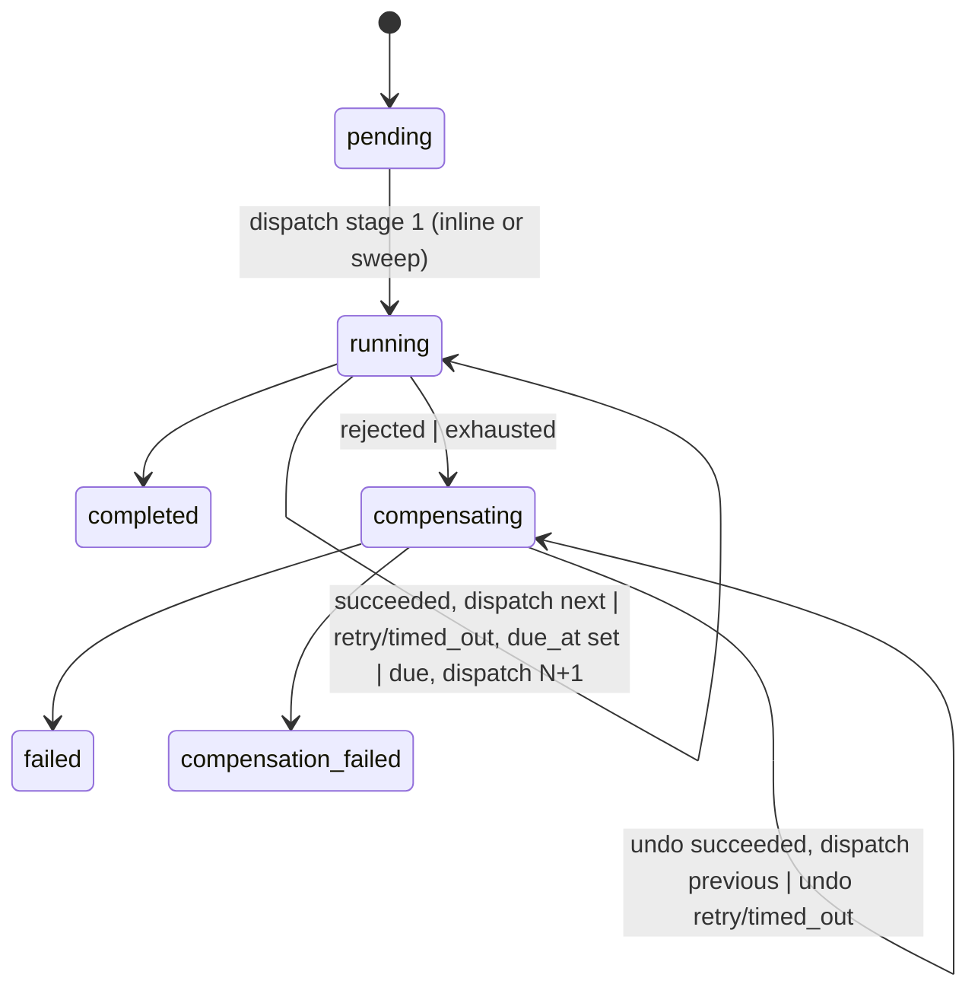

# Spec flow analysis: Asynchronous Order Orchestrator

Spec: `docs/plans/2026-10-13-1425-feat-async-order-orchestrator-plan.md`. Settled decisions in the planning context are taken as fixed. Deferred items in Scope Boundaries and the planner's open-question list (ack placement, outbox vs sweep, broker client, static page serving, live-consumer check at startup) are not re-raised.

## Phase 1: Codebase grounding

Greenfield. The repository holds a README, `docs/brief.md`, and the plan. No code, no conventions, no error-handling or validation patterns to ground against. Every default below is a proposal, not an observed pattern.

## User Flows

1. **Submit (client).** POST with idempotency key and payload. Branches: new key -> order created in `pending`, returned with id; same key + same payload -> existing order returned, no work; same key + different payload -> 409, nothing changes; invalid payload -> validation error. Terminal: 201 / 200 / 409 / 422.

2. **Happy run (orchestrator, stage).** `pending` -> `running` at stage 1, execute command published, result `succeeded`, attempt recorded, next stage dispatched, ... last stage -> `completed`.

3. **Transient retry (orchestrator, stage).** Stage reports transient failure, or deadline passes with no result. Attempt recorded as `retry` / `timed_out`, `next_due_at` persisted, sweep dispatches attempt N+1 when due. Late result from N ignored. Cap exhausted -> flow 4.

4. **Permanent failure and compensation (orchestrator, stage).** Rejection or exhaustion -> terminal reason recorded, `compensating`. For each completed stage in reverse: undo command, retry rules as execute. All undos succeed or none to run -> `failed`. Undo rejected or exhausted -> `compensation_failed`. A late execute result arriving while the order is `compensating` (e.g. attempt 1 of the rejected stage finally answers) is covered by R7: the orchestrator is waiting on an undo, so stage or kind mismatches and the result is dropped. No new transition needed; see G5 for the side-effect question it leaves behind.

5. **Crash recovery (orchestrator).** Restart with order in `pending` (AE10), in `running` with a command outstanding (AE7), in `running` waiting out backoff (AE12), in `compensating` (no AE; see gap 3).

6. **Config change on a live order (operator).** Stage removed from config, orchestrator restarts; running order follows its snapshot (AE15).

7. **Operator inspection (operator).** GET status by id, or open timeline page at `/orders/{id}`. Branches: known id -> state + history, polled until terminal; unknown id -> 404 / not-found page; poll fails -> last timeline kept, connection notice, polling continues.

The self-loops on `running` and `compensating` are where the spec is thin: each is a record-then-dispatch pair, and the pair is where crashes and races land.

## Gaps

### Critical

**G1. Record-then-dispatch relies on an atomicity the spec does not state.**
Flow 2 (success recorded, next stage not yet published) and flow 4 (exhaustion recorded, first undo not yet published) are the crash windows the Key Decision says the sweep covers ("a crash between saving state and publishing"). That holds only if the next attempt row, carrying its deadline, is inserted in the same transaction that records the previous outcome: crash before publish, deadline passes, sweep records `timed_out`, retries. If the attempt row is created after the commit, the order sits in `running` or `compensating` with no open attempt and no due time, and the sweep rule ("due time passed with no command outstanding") never fires. The spec does not say which. Two defaults, planner picks: (a) insert the next attempt row transactionally with the prior outcome; spec-consistent, no new column, costs one attempt and one deadline of latency on a crash. (b) write `next_due_at = now()` in that transaction and let the sweep dispatch; no wasted attempt, one more column, and the sweep becomes the only dispatcher. Either way, the same rule must apply to the `running -> compensating` entry.

**G2. One orchestrator instance is not one writer.**
The sweep timing out attempt N and the result consumer handling N's result interleave at `await` points inside one asyncio process. Duplicate result deliveries (at-least-once applies to results too) interleave the same way. Both can close the same attempt row. Default: `SELECT ... FOR UPDATE` on the order row for the whole transition, and the attempt close is `UPDATE attempts SET outcome = ?, finished_at = now() WHERE order_id = ? AND stage = ? AND kind = ? AND attempt = ? AND finished_at IS NULL`; zero rows affected means the result is stale and is acked and dropped. R7's "ignore a result whose identifiers do not match" is this guard; the spec should say it is enforced at write time, not by an in-memory check before the write.

**G3. `compensating` has no cursor.**
R15 says "current stage when running". An order restarted mid-undo (AE7's compensating twin, which has no acceptance example) needs to know which stage is being undone and which remain. Default: `current_stage` is set in `compensating` as well as `running`; the remaining undos are the stages before `current_stage` in the order's snapshotted list. Status exposes `current_stage` in both states. Add an acceptance example for restart during compensation.

**G4. AE13 asserts something the template cannot observe.**
A stateless stage cannot know it already ran a command; "work runs once" is a property of the handler's idempotency (R23), not the template. Default: template does not dedupe; the handler may re-run and publish a second result; the orchestrator records one attempt because of G2's guard. Reword AE13 to assert the observable: one attempt row, and the handler was called with the same `(order_id, stage, attempt)` both times.

### Important

**G5. Is the failing stage undone?**
Attempt 1 of `fraud` times out but actually ran; attempt 2 is rejected. R13 undoes "completed stages" only, so `fraud`'s side effect stands. Default: spec-literal (completed stages only). Note for the planner: with the no-op default undo, including the failing stage costs nothing and matches classic saga semantics; it is a one-word change to R13.

**G6. Timeout on the final allowed attempt.**
AE3 fixes transient-on-last-attempt as `exhausted`. Deadline-on-last-attempt is unfixed: `timed_out` or `exhausted`? Default: `exhausted`, with `reason = "deadline passed"`. The outcome column says why retries stopped; the reason says what happened.

**G7. Undo failure: stop or continue?**
R14 ends the order in `compensation_failed` when one undo is rejected or exhausted; it does not say whether remaining undos run. Default: stop at the first failed undo. History shows which stages never received an undo attempt. The operator can tell from the history alone.

**G8. Handler raises an unexpected exception.**
Not a simulated failure, not in the outcome set. If the template lets it propagate, the message is nacked and either requeued forever or dead-lettered silently; the orchestrator learns only via deadline, and the exception vanishes. Default: template catches, publishes `retry` with `reason = type(exc).__name__`, acks. The retry cap bounds a deterministic bug.

**G9. Outcome script semantics.**
Four unspecified points. (a) Keying: AE5 scripts an undo, so the key is `(stage, kind, attempt)`. (b) Fallback: attempts a script does not list, for a stage it does list. Default: `succeeded`, so a scripted stage is fully deterministic; stages absent from the script use their profile. (c) Validation at submission: unknown stage name or unknown outcome token. Default: 422, validated against the snapshotted stage list. Attempt numbers beyond the cap are accepted and ignored. (d) R26 comparison: is the script part of "the payload"? Default: yes, it is in the request body and in the comparison. Also: AE6 needs a `delay` outcome (or a latency override) in the script vocabulary, and the script for a stage must travel in the command since the stage is stateless.

**G10. Idempotency key mechanics.**
R9 says "accepts a client-supplied key" without saying required or optional, header or body, or what happens when two POSTs with the same key race. Default: required `Idempotency-Key` header, 422 when missing; unique index on the key; on integrity error, re-read the existing row and apply the R9/R26 comparison. Payload comparison is on canonical JSON (sorted keys), stored as a hash on the order row.

**G11. Queue topology ownership when a stage has zero consumers.**
Order submitted while a configured stage's container is down or its name is misspelled. If only the stage service declares its queue, publishing to the absent stage is unroutable, not a timeout, and the "stage never answers" path the sweep is designed for never engages. Default: orchestrator declares every per-stage queue (durable) and the results queue at startup; the template re-declares its own queue idempotently. With that, the zero-consumer case degrades as designed: timed out, retried, exhausted, compensated, `failed`; and an undo whose stage has no consumer ends in `compensation_failed`.

### Minor

**G12.** Attempt numbering: per `(order, stage, kind)`, so undo attempts restart at 1. R7 matches on kind, so this is consistent; state it.

**G13.** `reason` on `compensation_failed`: the original rejection reason, with the undo failure visible in history. Not both in one field.

**G14.** `compensating` with zero completed stages: pass through `compensating` to `failed` in one transaction so the state diagram and the transition table agree, or document the direct `running -> failed` edge. Default: one transaction, both transitions.

**G15.** R28's "waiting to retry" rendering is derivable (last attempt is `retry`/`timed_out`, no newer attempt) but exposing `next_attempt_due_at` on status makes it explicit. Default: expose it.

**G16.** Unknown and malformed order id: both 404. Submit returns 201 on create, 200 on idempotent replay.

**G17.** Malformed command (stage side) or malformed result (orchestrator side), e.g. schema drift between images: ack and drop with a log line; the orchestrator recovers via deadline. Default: one shared `contracts` module (pydantic models) imported by both the orchestrator and the template so drift is a build error, not a runtime one.

**G18.** Deadline is an absolute UTC timestamp set by the orchestrator; the template compares against its own clock. Containers share the host clock, so skew is not a concern in Compose; say so.

**G19.** Sweep interval must be well under the dispatch deadline, or timeouts are detected up to one interval late. Default: interval 1s, deadline 10s or more, both config.

**G20.** Per-stage attempt cap, backoff, and deadline: orchestrator config keyed by stage name with a global default, so adding a stage needs no orchestrator config entry unless it overrides (R2 says no code change; config entries are fine).

## Questions

1. **Next attempt row in the same transaction, or `next_due_at` and sweep-only dispatch?** (G1) Stakes: the crash-between-save-and-publish recovery the Key Decision promises only exists if one of the two is chosen; (a) wastes an attempt per crash, (b) adds a column and makes the sweep the single dispatch path. Default: (a), inline publish after commit, sweep as backstop.
2. **Is the write-time guard the R7 mechanism?** (G2) Stakes: without it, the sweep and a live result can both close the same attempt. Default: yes, guarded update, zero rows means drop.
3. **Does `compensating` carry `current_stage`?** (G3) Stakes: restart mid-undo cannot resume otherwise. Default: yes, and add an acceptance example.
4. **Reword AE13?** (G4) Stakes: as written, the test cannot be satisfied by a stateless template. Default: assert one attempt row and two handler calls with identical identifiers.
5. **Undo the failing stage?** (G5) Stakes: a timed-out attempt that actually ran is never compensated. Default: spec-literal; flag for the planner.
6. **Deadline on last attempt: `exhausted`?** (G6) Stakes: two implementers pick differently and the AE3 test and the timeout test disagree on the outcome column. Default: yes, reason carries the timeout.
7. **Stop at first failed undo?** (G7) Stakes: whether the history after `compensation_failed` shows partial or full undo coverage. Default: yes, stop.
8. **Handler exception -> `retry`?** (G8) Stakes: an unhandled bug otherwise surfaces only as a silent timeout with no reason in history. Default: yes, reason is the exception class name.
9. **Outcome script: key, fallback, validation, part of R26 comparison?** (G9) Stakes: AE2 to AE6 are only deterministic if fallback is fixed; a script that names a missing stage silently does nothing otherwise. Default: `(stage, kind, attempt)`, unlisted attempts succeed, 422 on unknown stage or token, part of the comparison.
10. **Idempotency key required header?** (G10) Stakes: AE1 and AE11 cannot be written until the transport is fixed; racing POSTs create two orders without the unique index. Default: yes, 422 when missing, unique index.
11. **Orchestrator declares all queues?** (G11) Stakes: a down or misnamed stage is an unroutable publish error instead of the timeout path the sweep was designed for. Default: yes.

## Recommended Next Steps

- Settle Q1 and Q2 before the schema: they decide whether `next_due_at` lives on the order row and whether attempts carry `finished_at IS NULL` as the outstanding marker. Both are columns, not code.
- Settle Q3 and Q5 before writing R13/R15 into the transition table; add the compensating-restart acceptance example.
- Reword AE13 (Q4) before the template's test plan is written.
- Fold Q6 to Q11 into the plan as stated defaults; none needs discussion, each needs a sentence so two implementers do not pick differently.
- Do not reopen ack placement, outbox vs sweep, or broker client; the planner's open-question list already owns them.
